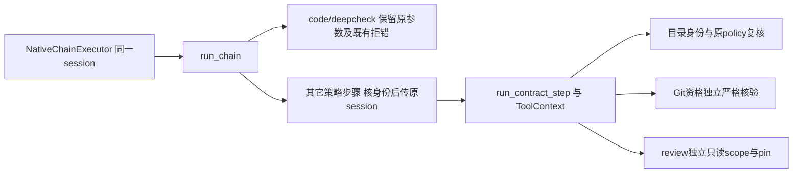

# LA-2a：策略步骤保留宿主会话

状态：设计已冻结；实际实现经独立SPEC→不同QUALITY各C0/I0/M0，root独立81项软件回归通过，完整preflight三道通过，阶段发布待执行。调用链源基线8b1afd4，LA-1软件验收已发布f648812，不改变本片既有链路。本片是[Linux准入路线](./2026-10-12-linux-admission-receipt-design.md)的调用链前置，不是完整LA-2准入或自动模式放行。

## 1. 真实问题与复用

NativeChainExecutor向内置run_chain的每个生产步骤传递同一WorkspaceSession，但chain.py仅向code/deepcheck直接继续传递；其它步骤借用git_status_session的资格筛选。snapshot没有GitWorkspaceIdentity，因此plan/audit/merge/review等策略步骤会丢会话。Git资格不应成为传递目录会话的条件。

三问已确认：真实传播缺口；已有WorkspaceSession、policy与工具层身份检查可复用；只影响chain→run_contract_step的参数传播，不修改状态机、准入、后端或会话所有权。root已实际读取chain、autonomy、runner、workspace及ToolContext，并完成sequential-thinking104–106。研究见[持续对照](../../agent-landscape-live.md)，固定Codex需求/选择/执行快照分层只作机制参考，不复制代码。

| 方案 | 收益与风险 | 选择 |
| --- | --- | --- |
| A：独立核对策略会话身份，传原对象 | 复用既有所有权与工具核验，最小调用链改动 | 推荐，沿用户自主采用推荐方案授权推进 |
| B：将Git资格扩大至snapshot或自定义policy | 混淆会话传递与Git权限，破坏现有默认policy等值门 | 不适配 |
| C：为每步新建目录FD或翻转ready | 重复资源所有权；未完成宿主准入便放行 | 不适配 |

## 2. 架构与传递合同

chain循环内新增局部policy_session，仅满足以下全部条件时为原workspace_session，否则为None：

- policy是SandboxPolicy，workspace_session是WorkspaceSession；沿用现有isinstance，不新增exact-type全局限制。
- session.ticket_id、policy.ticket_id与chain ticket_id一致。
- session.run_id与policy.run_id一致。
- session.workspace_root、policy.workspace_root与chain已resolve的workspace一致。
- policy.step与当前name一致。

不要求session.kind=git_worktree、GitWorkspaceIdentity或policy==session.policy(name)。宿主合法的自定义process/wall/output上限仍传原policy，不以重建默认policy覆盖。此核验只筛选可传对象，不建立执行授权，也不证明FD仍有效。

向run_contract_step传递的规则：policy非None且step为code/deepcheck时，继续原样传workspace_session，包括不匹配对象，让原_contract_plan_error产生既有身份拒绝；其它步骤改传policy_session。无policy仍为None，缺会话不合成对象、不创建或关闭FD。旧git_status_session筛选不再决定会话传递；Git真实资格仍由builtin._git_status_available及git_status执行时独立判断，不修改这些函数。

## 3. 安全与兼容边界

旧tests/test_chain.py合法Git正控、无policy None及stale-run None保持。code/deepcheck错会话不得被提前过滤成None，不能削弱verification_session_identity_mismatch等既有错误。

普通review收到匹配session仍由runner设置只读Scope、派生reviewer policy和隐藏工单目录；ToolContext走独立只读wrapper与Reviewer pin，不回退可写包装。git_status同时拒绝review和read_only_workspace。不能把传递成功写成Landlock已具备完整Reviewer能力或Reviewer已借用session FD。

会话与FD由WorkspaceSession持有和关闭；chain只传引用。未知/已关闭/替换FD由现有消费边界拒绝，本片不新增或放宽读取。不存在回退裸命令、重试副作用调用或吞掉KI/SE的新分支。准备检查、policy_contract_ready=False、select_sandbox、LA-1诊断、网络与资源执行、CLI入口与MCP均不改。

技术设计技能的职责/依赖/数据流分层用于本片；Java/Spring/MySQL模板规则不适用本Python内部调用，接口签名和模型不变，无HTTP/MQ/表/依赖/权限新增。入口门禁技能用于区分内置Native入口、直接policy链和legacy无policy调用，不将检查位置或参数存在当执行事实。

## 4. 验收合同

- 先对snapshot plan/audit/merge/review传递取得有效断言RED，非导入错误；真实调用run_chain，替换下游仅用于记录实参，不以另写模拟chain代替。
- 合法git_worktree、snapshot和自定义资源上限policy均保留原session与原policy对象；chain不调用session.close或lease.release。
- 非WorkspaceSession、缺policy、stale run、错ticket/错workspace对非code/deepcheck不传；policy自身错step/ticket/root继续由既有chain前置拒绝。
- code/deepcheck匹配和不匹配session仍原对象传递；保留实际runner的verification身份拒绝回归，不将仅记录参数当拒绝证据。
- review接session后registry仍无git_status、直接调用仍git_broker_unavailable，既有只读Scope/wrapper拒绝不变；自定义资源policy的Git资格仍False，默认合法非review Git资格正控仍True。
- 原chain测试与autonomy/runner/工具关联回归、独立SPEC→不同QUALITY、compileall -j1、完整preflight及阶段main提交。源码仅chain.py与相关测试最小范围，不修改Git工具授权函数或后端。

软件传递验收不能关闭FD原生安装、Linux生产准入、CLI/MCP一致性、LA-2整体、模型90%或R2/R3总门。后续宿主准入须继续验证真实session/policy/helper/ELF、准备与执行身份、manager/资源/observer/cleanup，不由本片代替。

## 5. 设计自检

语法/文档：合同和真实符号已核，实际候选compileall-j1及两轮独立审查通过；依赖/调用链：参数签名不变、会话/Git分离；逻辑/边界：实际断言RED后11项chain测试通过；异常处理：无新重试/捕获；关联模块：4项身份/只读及66项关联回归通过；兼容安全：legacy与code/deepcheck拒错保留；可运行性：root共81项软件回归通过，完整preflight三道通过、发布待执行，原生与产品准入不授通过信用。详见[实施记录](../plans/2026-10-12-chain-policy-session.md)。
