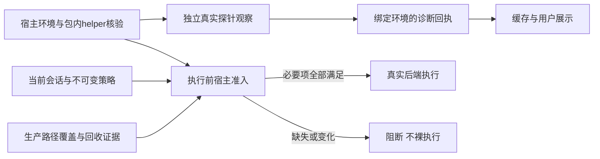

# Linux 运行保护准入回执：分阶段设计

状态：LA-1软件门通过；实际实现经SPEC→不同QUALITY复审零遗留，23项定向通过，根代理完整preflight三道通过、关联127项116通过/11既有跳过，已发布main `f648812412dd5ba53e24cb4bb5df058eb937a510`。没有产品放行或installed原生信用。设计基线 main `8b1afd4d347173453252d3d22ba7ec5cdbd805f5`，实际执行见[实施记录](../plans/2026-10-12-linux-admission-diagnostic.md)。沿用用户“推荐方式自主推进”授权，不增加系统权限、服务或安装步骤；安全与独立验收门不变。原合同为 [R2 §12.1/14.1](./2026-09-23-r2-cross-platform-isolation-design.md)，研究见[持续对照](../../agent-landscape-live.md)。

## 1. 需求与现状

真实缺口不是缺少一个 `ready=True`，而是运行保护的实测身份没有闭合到实际产品选择与执行。三问已确认：问题真实；存在可复用实现；调用链影响限定为后续宿主准入，不改变工单状态机。

| 层次 | 当前事实 | 不能外推的结论 |
| --- | --- | --- |
| 平台诊断 | 历史独立原生评分曾为9/10（[研究分账](../../agent-landscape-live.md)）；uniform为非关键项，当前doctor不跑完整tree/resource/uniform探针，本片未重新评分 | 不绑定历史分数到当前环境，不等于当前工单已选择生产后端 |
| 文件/资源 | 分层POSIX工单、目录FD、DENY命令、TasksMax、输出/超时/回收已有 | 不重建；不自动覆盖获批网络路径 |
| 策略 | `LandlockSandbox._checked_policy_workspace` 支持DENY单一读写根，拒绝冲突 | 不支持任意嵌套deny/任意读取根 |
| 选择/执行 | `select_sandbox`未选择Landlock；NativeChainExecutor检查policy_contract_ready | 不能绕过prepare或直接翻转property |
| 网络候选 | `execute_linux_leased_connect_candidate`已有审批scope/代理握手和收尾 | 尚无资源监督、USER_NOTIF与会话目录FD合流 |
| 回执 | doctor诊断、评分器与helper摘要核验存在 | 没有完整的环境绑定、持久化与失效消费链 |

普通workbench已设置 `isolate_git_metadata=True`，code内无`.git`；`WorkspaceManager`旧默认不改。真实nested-deny仍须拒绝，不能为得到PASS删除保护路径。

## 2. 方案选择

| 方案 | 收益/成本 | 决定 |
| --- | --- | --- |
| A：宿主分层准入，缓存只作诊断，执行前重新核验 | 复用当前对象和探针；需要显式证据范围与消费者 | 推荐 |
| B：doctor评分或磁盘JSON直接授权 | 接线少，但混淆诊断与生产，旧缓存/项目输入可误放行 | 不适配 |
| C：立即重构后端/新特权探针/第二套资源监督 | 覆盖大、回归风险高且重复已有能力 | 暂缓 |

采纳固定Codex/OpenHands的结果与来源分层，不复制实现。技术设计技能的职责/依赖分层适用；其Java/Spring/SQL模板条款不适用于本Python内部模块，本片不新增REST、数据库或框架依赖。

## 3. 架构与授权边界

磁盘回执不指向执行箭头。准入不接受模型bool、项目JSON、旧doctor字典或测试传入的PASS作为授权。诊断分数与生产策略覆盖分别存储和核验，候选/installed观察不能升级为生产覆盖。

宿主是可信控制面；项目、模型、被沙箱约束的子进程是不可信输入。原R2明确不防同权限宿主注入或管理员攻击。本地helper摘要核验只证明包内一致性，不冒充发布者认证或执行对象固定。

## 4. 数据与失效合同

未来正式能力回执保留原§12.1字段：schema_version、platform、os_build、architecture、helper_sha256、policy_schema_version、checked_at、status、conformance。新增范围/生产覆盖摘要必须通过独立schema版本设计，不能让旧读取方静默忽略安全字段。

本阶段LA-1使用独立诊断scope，不冒充正式 `CapabilityReport(status=ready)`：

- 平台仅linux；架构由宿主规范化为x86_64或arm64；OS身份由宿主读取，不接受请求提供。
- helper与manifest使用现有 `bundled_linux_helper`/`verify_native_helper`；记录实际字节摘要。缺失、链接、损坏或核验不完整不能生成摘要绑定。这两个函数没有ELF machine校验；architecture只记录宿主CPU，不认证helper机器架构，相关核验为后续独立前置，不凭旧探针成功补该信用。
- policy schema来自现有常量；观察范围、检查时间、结果摘要来自宿主真实调用，LA-1状态固定incomplete，不接受ready/blocked或caller提供status。
- 成功绑定不等于准入成功。生产选择/网络合流未闭合时，固定显示未启用；跳过、未知cleanup或缺manager保持阻断。
- 无路径、SID、FD、argv、环境变量、SD或异常正文进入展示/磁盘诊断；run/ticket/step及策略/目录对象绑定留在宿主会话内，模型不能提供替代身份。

LA-1固定exact keys：`scope=linux_admission_diagnostic`、`schema_version=1`、`platform=linux`、`os_build`、`architecture`、`helper_sha256`、`policy_schema_version`、`checked_at`、`status`、`reason`、`observations`、`observation_coverage`、`cleanup_status`。OS字符串为1–256可打印ASCII字符，无法读取/不合法时为null；架构仅x86_64/arm64，未知为null；helper为64位小写hex，缺失/核验失败为null；policy版本为真实正整数、拒绝bool；时间为宿主UTC秒精度ISO8601加Z。observations exact keys为 `minimal_probe`、`protected_path_probe`，值为现有探针严格bool摘要或null（未调用/返回畸形）；false只表示旧摘要未通过，不保证完整执行。固定 `observation_coverage=legacy_probe_summary_only`、`cleanup_status=unknown`，不载入原detail或整个旧doctor字典。

status固定incomplete；reason仅 `observation_incomplete`、`helper_unavailable`、`helper_changed`、`unsupported_environment`、`invalid_observation`。理由优先级为宿主环境不可用 → helper不可用 → helper观察中变化 → 探针返回畸形 → observation_incomplete。现有NativeProbeResult没有executed/cleanup，protected.executed=True也含异常路径；即使两摘要true且helper一致，仍只能observation_incomplete。非Linux调用collector固定失败 `linux_admission_unavailable`，不伪造platform=linux回执。传入ready/blocked、未知字段/枚举、bool伪整数或不一致组合被拒绝。wire输入必须exact bytes，单行canonical ASCII JSON加LF，总长（含LF）最多16KiB；JSON固定 `sort_keys=True, separators=(',', ':'), ensure_ascii=True`，重复key拒绝，重序列化须与原bytes完全相同。边界作为命名常量并有负控。

合法组合固定如下，validator也逐项核验；宿主身份完整指OS/架构非null、policy版本合法：

| reason | 宿主身份 | helper_sha256 | 两摘要 | 是否调用探针 / 绑定检查 |
| --- | --- | --- | --- | --- |
| unsupported_environment | OS或架构至少一项null | null | 都null | 不调用，绑定False |
| helper_unavailable | 完整 | null | 都null | 不调用，绑定False |
| helper_changed | 完整 | null | 都null | 观察中A→B或A→缺失；丢弃跨helper摘要，绑定固定False |
| invalid_observation | 完整 | 前后相同的合法实际摘要 | 至少一项null，其余bool或null | 结果畸形/普通异常；异常后不启动后续探针，绑定False |
| observation_incomplete | 完整 | 前后相同的合法实际摘要 | 都为严格bool | 仅旧summary；当前环境逐项匹配时绑定True，仍无执行权 |

helper_changed绝不保存B来使跨helper观察“当前匹配”，也不把A残留成可用绑定。回执在正常返回前复核helper；first probe普通异常仍要完成现有责任的收尾并复核绑定，不运行第二probe。KI/SE不生成回执。无论两摘要true/false，均不能推导cleanup或完整执行。

失效规则：每次读取先比对当前平台、OS、架构、helper实际摘要和policy schema；任一变化、缺失、畸形或读取错误使缓存不可用。`checked_at`仅审计时间，不因日期新而信任。LA-1缓存不参与执行，因此不存在“未过期即可启动”的捷径。

LA-1只在内存生成和验证诊断，不写磁盘。LA-4存储仅用户数据目录的固定宿主拥有位置，绝不项目目录；须先核对目录/文件链接、owner、权限、尺寸及替换边界。现有checkpoint原子写使用可预测.tmp和路径写入，不直接当安全缓存机制；不能用普通`Path.write_text`冒充安全存储。持久化未达标不能声称完成§12.1。

## 5. 内部接口与生命周期

LA-1新增内部 `linux_admission_diagnostic.py`，不接ToolContext、模型工具、Web输入、selector或NativeChainExecutor授权。`collect_linux_admission_diagnostic()` 无外部参数，读取当前OS/架构/真实包内helper与schema、复用现有两个探针，在探测前后核对helper摘要，生成不可变诊断；不解析detail或猜executed/cleanup。`serialize_linux_admission_diagnostic(report)` 返回canonical bytes；`validate_linux_admission_diagnostic(wire)` 返回不可变诊断，仅验证有限格式、不认证来源或授权，畸形输入抛固定ValueError `invalid_linux_admission_diagnostic`、不带原正文。`linux_diagnostic_binding_current(report)` 重新读取当前宿主绑定，返回诊断是否仍匹配，不执行任务且不能返回“允许执行”；畸形或读取错误返回False，KI/SE原对象传播。没有用户可注入的observer/clock/helper路径/ready参数，不引入第二套探针或评分器。

诊断不创建任务工作区、不持有任务FD、不负责回收任务。后续LA-2准入必须借用现有session目录FD并验证其未关闭、未替换，保留真实policy/ticket/run/step与模型调用前prepare；不得让诊断对象拥有或关闭借用FD。

缓存损坏：返回固定不可用诊断，执行继续阻断；不读取项目回退文件、不执行未知helper探测版本。诊断执行异常：保留KI/SE原对象和现有回收责任，普通异常固定脱敏；不以失败重试裸命令。

## 6. 分片验收与继续顺序

| 片段 | 必须证明 | 本片不能声明 |
| --- | --- | --- |
| LA-1：绑定诊断 | 真实宿主身份、helper变化失效、严格有限schema、缺失/畸形/skip/incomplete/未知cleanup负控；仅内存无持久化 | ready、自动模式、全策略或§12.1完整通过 |
| LA-2：生产准入 | 当前真实session与DENY政策、包内后端实际选择、准备与执行身份一致；保留旧后端兼容与NoIsolation拒绝 | 非产品网络候选覆盖生产路径 |
| LA-3：获批网络合流 | 既有scope/lease接资源监督、USER_NOTIF、同一目录FD、取消/过期/代理与任务回收；实际安装包产品入口 | 单独代理正控补全资源/文件能力 |
| LA-4：正式回执与UI | 当前生产路径独立实测满足原§14.1、环境变化失效、正式回执持久化/消费、CLI/MCP范围真实一致 | Windows/macOS或R2/R3总体通过 |

LA-1 TDD先对缺失/畸形/平台/OS/helper/policy漂移、旧诊断字典和伪造ready取有效RED，后实现最小绑定；测试替身只证明契约。Linux x64/ARM64安装包真实核验另账。独立SPEC后不同QUALITY、完整守护与阶段main提交保留；Windows8b1afd4原生结果并行观察，失败优先定位，不借本片信用。

不扩大VR-1为所有syscall，也不把退出13/stderr猜测当OS违规来源。统一错误/CLI/MCP仍按已有VR-1单独验收。真实模型401及六步/90%门不由诊断模块替代。

## 7. 当前自检结论

需求/现有实现/调用链已核；环境缓存与授权分离，原保护、评分与跨平台边界保留。首轮设计SPEC指出旧探针缺完整执行/cleanup、helper无ELF机器校验及历史评分混用风险；修后SPEC零遗留。不同设计QUALITY另指出跨helper摘要与reason组合不明，修后复审C0/I0/M0；五种组合、A→B/缺失全清绑定与摘要、异常不启动后续probe已明确。root实际sequential-thinking92–94，完整读原R2合同与相关实现、模板/规则，按Python范围而非Java框架生成此设计。当时进入详细实施计划、尚未编码；随后实际软件实现及系统时钟异常修复已完成独立SPEC→不同QUALITY复审，详见实施记录。持久化/正式授权仍属后续片，没有installed原生或R2/R3验收信用。
