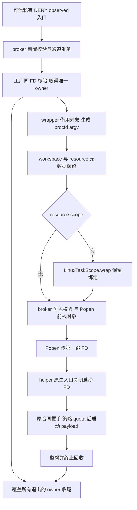
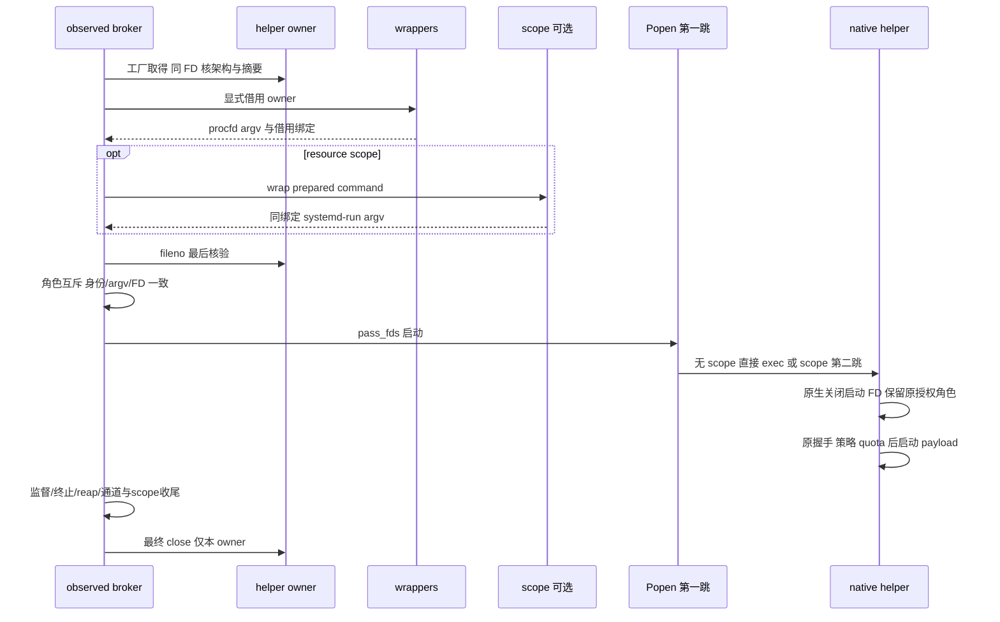

# LA-2b3：Linux 助手同对象 dispatch 设计

状态：DESIGN 起草记录及后续复核；当前进度见第 9 节。本文最初与 LA-2b2 五路径候选分开，不进入其发布集合。root 已实际执行 sequential-thinking 122–124；本文起草者回读了前片设计、完整计划、对象源码与涉及的调用链。用户已选择常规推荐方案自主推进、main-only；本文件不要求新 worktree、配置服务或权限。

## 1. 需求背景与三问

真实问题已确认：`LandlockSandbox.prepare_policy` 和两层 metadata wrapper 对 helper 路径反复校验，最终以 pathname 启动。取得对象后 rename、unlink 或同名替换仍可能改变后续路径选取；LA-2b2 对象工厂尚无生产 consumer，不能授同对象执行信用。

现有实现可复用：`open_linux_helper_object(binary, manifest)` 返回独立 `LinuxHelperObject`，同一个打开 FD 核架构与摘要；`PreparedCommand` 已携带 `pass_fds/cwd`；observed broker 已有通道、scope、Popen 与收尾监督链。冻结对象源码 SHA256 为 `88f1fe97e36c87ca6251ed9b9c887990f544fed1fafb0ea36779d8cd32d893e8`。复用其 active/closed/unknown 所有权语义，不重新设计 owner。

调用链影响已确认：workspace/resource/scope 重建命令时需保留借用绑定，broker 必须承担唯一 close 责任；原生入口需消除启动 FD 的 payload 继承能力。普通 broker、Git、Reviewer 和 leased-connect 的生命周期未覆盖，不能从本片推导它们已满足 same-FD 合同。

本片目标是建立 DENY observed 的私有同对象 dispatch 候选，覆盖无 scope 的 violation 和有 scope 的 resource 两条链，并规定进入真实生产链的验收出口。所得信用限于一次 dispatch 中核验与启动指向同一持有 regular 对象。它不证明同 inode 字节不可变、摘要发布者认证、祖先信任、动态依赖可信、模型前 prepare 已固定对象或整体 R2/R3 ready。

### 1.1 方案选择

| 方案 | 收益 | 成本与边界 | 决定 |
| --- | --- | --- | --- |
| A：broker 每次 dispatch 取得 owner，wrapper 借用，经 procfd 启动 | 复用现有对象与 observed 监督；有限范围可独立验收 | 需精确元数据传播及两种启动拓扑实测；无内容封印 | 采纳，推荐最小兼容方案 |
| B：sandbox 在 prepare 后缓存全局 owner | 少一次取得对象 | prepare 与工单/命令生命周期错位；增加跨 session 共享与收尾责任 | 不适配 |
| C：全入口一次改为新 launcher 或 sealed memfd | 可统一更广生命周期或固定字节快照 | 扩大 Reviewer/Git/leased 与原生安全身份范围，超出当前缺口 | 暂缓，另行设计验收 |

## 2. 整体架构与职责

唯一 owner 位于 broker 本地命令作用域，不存入 sandbox、ToolContext、WorkspaceSession 或全局 cache。owner 从取得成功开始覆盖 wrapper 调用之前到全部 supervisor/channel/scope 收尾之后；包装失败、启动前返回及信号也必须进入同一收尾范围。broker 可以把对象引用借给包装器，引用不转移 close 责任。

workspace FD 归 session 或 Reviewer 自身 pin；control/resource socket 归现有通道监督；scope cgroup FD 归 `LinuxTaskScope`。helper owner 只能关闭自己的对象，禁止遍历并关闭全部 `pass_fds`。`ToolContext.close` 继续仅关闭其 `_pinned_read_only_workspace`，不能抢 session owner 或 helper owner。

### 2.1 当前源码锚点与拟修改责任

| 当前源码 | 已观察行为 | 下一阶段必要责任 |
| --- | --- | --- |
| `src/icode/isolation.py:806` `PreparedCommand` | 仅 argv、pass_fds、cwd | 新增可选借用对象元数据，默认兼容旧构造 |
| `src/icode/isolation.py:1174` `prepare_policy` | 工作区静态检查后按路径核 helper | 保留模型前现有合同；候选借用分支独立复用策略检查 |
| `src/icode/isolation.py:1195` `_with_workspace_object_fd` | 重建命令，pass_fds 覆盖为 workspace 一个 FD | 合并已有启动 FD，保留同一借用对象，明确角色冲突拒绝 |
| `src/icode/isolation.py:1248` resource wrapper | 添加 quota 参数后重建 PreparedCommand | 保留借用对象、pass_fds、cwd，不取得 owner |
| `src/icode/isolation.py:1277` / `1422` metadata wrappers | prepare 与底层均按 helper 路径核验 | 仅显式候选借用分支用 held FD，不重新选择 pathname |
| `src/icode/linux_task_scope.py:183` `wrap` | systemd-run 重建 PreparedCommand | 完整保留借用元数据；不据此宣称第二跳保留 FD |
| `src/icode/execution_broker.py:181` / `295` observed core | wrapper→scope→FD 合并→启动→finally | 唯一 owner 作用域、角色互斥与最后启动前核验 |
| `src/icode/execution_broker.py:440` / `497` process core | 输入可早返回；随后 Popen | 候选调用方收尾覆盖这些返回，Popen 前最后验证不可丢 |
| `native/linux/icode_landlock.c:1611` | close_range 只保留 workspace/channels | 启动 FD 不进入 preserved 集合；保持原先清理与策略顺序 |

上述行号是起草时回读锚点，实施前按符号重新定位。只做这条候选链的必要修改；没有 HTTP、MQ、数据库或 Java 服务层，tech-design 模板的这些字段不适用。

## 3. 技术设计与时序

### 3.1 取得、借用与最终启动

可信入口先完成 Linux、LandlockSandbox、DENY、无 allowed_domains、argv、工作区、timeout/output limit 及原先资源前置条件检查；显式候选失败拒绝，不能调用旧路径、PATH、未 observed 命令或裸 host 命令。helper/manifest 来源仍是既有可信 sandbox/resolver 选择结果，不新增模型可选路径、架构、摘要或 FD 参数。

broker 调用现有工厂取得对象，立即登记收尾责任，再交候选 wrapper。wrapper 由 `owner.fileno()` 派生 `/proc/self/fd/N` 作为 helper 的实际程序路径，helper 参数、`--parent-pid`、workspace identity、DENY、metadata/runtime roots、observer 与 quota 合同保持现有含义。获得 owner 后，不再用 `Path(self.helper).is_file()`、旧 verifier 或 pathname 重开来选择启动对象。

候选分支仍须执行 `_checked_policy_workspace` 及现有 policy、metadata、execute-only、runtime root 校验；仅剥离重复 helper 路径验证，不以跳过整个 `prepare_policy` 方式绕过策略检查。旧无绑定调用继续当前行为且不授新信用。取得对象后的 rename/unlink 会影响 nlink/ctime，不能把它们误当不同对象；可启动 held regular 对象，或因真实执行合同拒绝。任何结果都不得执行同名替换对象。

broker 在 wrapper 与 scope 完成后，核命令携带的引用就是本次取得的 owner，`fileno()` 返回仍活、regular、同 dev/ino 的对象；fd 必须为实际整数且至少 3。无 scope 核 argv[0] 为该 procfd；有 scope 按可信 `LinuxTaskScope.wrap` 生成的第一处分隔符核内层 helper 程序位置为该 procfd，不能在 payload 参数中搜索一个相同字符串冒充绑定。helper FD 与 workspace/control/resource 角色不能 alias，pass_fds 不能重复，也不能通过 set 去重掩盖冲突。未知、丢失、替换绑定或 dead/reused FD 均启动前拒绝。最后验证位于 Popen 之前，过程中不得重新包装或变更 FD 集合。

这依赖可信宿主不外部 close/dup2 或并发操纵 owner 的现有合同；最后 fstat 并不能消除恶意并发复用、同对象 FD 复用或同 inode 改写。借用元数据与 Python 引用仅是传递合同，不能单独证明安全身份；broker 的本地 factory 结果、角色校验和真实启动证据共同约束它。

### 3.2 scope 与 payload 边界

无 scope 时 Python 的 `pass_fds` 将启动 FD 交给直接 helper 第一跳；有 scope 时第一跳是 `/usr/bin/systemd-run`。Python 传递与 `LinuxTaskScope.wrap` 元数据保留只说明第一跳准备，不证明 systemd-run 内部再次 exec 时 FD 被保留、procfd 仍解析原对象或 parent-pid 监督成立。该第二跳必须按实际 systemd 版本和原生包测试，失败则该 scope 合同不通过，不改为无 scope 路径继续执行。

helper 启动 FD 的用途在加载 helper 后结束。原生 `close_inherited_descriptors_with_workspace` 当前只保留授权 workspace/control/resource；helper FD 不新增为保存角色，不传给 payload。先验证角色互斥，再利用现有 close_range 关闭它；若原生实际测试发现需要必要修改，应保持 parent-pid、认证通道、policy 和 quota 原合同，重新完成设计/双审与原生矩阵，不能为通过测试扩大 payload FD 白名单。

payload 负控须用最小原生 fixture，首个 fstat 在测试自身 open 或目录枚举之前验证原 helper FD 为 EBADF，避免数字复用误读；随后另核 payload 初始 `/proc/self/fd` 不包含 helper 的对象身份。这是测试观测顺序约束，不是永久生产 test-only API；不承诺 payload 永远不能自行打开其它政策允许的路径。

### 3.3 异常、返回与回收

取得 owner 失败由工厂清理自有打开资源；成功后由 broker 的外层统一 finally 清理。外层必须覆盖现有 setup、wrap/scope/metadata、FD 合并、monitor/resource 构造、Popen 前校验及输入早返回、Popen、握手、observer/resource 故障、正常退出、timeout、output_limit、KeyboardInterrupt、SystemExit。不能只在现有 Popen 后的 finally 插一个 close。

所有独立清理均尝试：先按原监督合同停止/reap 进程及线程，清理 resource/monitor/scope/endpoints，再清理 helper owner；单项失败不能跳过其余项。复用 `_select_cleanup_error` 的优先关系，信号原对象不被普通清理错误掩盖；helper close 未确认或 detected reuse 不重试、不关闭陌生复用 FD，也不能报告资源已全部确认回收。正常路径须真实 FD 关闭证据，故障路径须区分“已确认关闭”和“unknown”。

候选 pre-spawn 拒绝可复用已有 `isolation_unavailable`/`launch_failed` 等固定错误与 incomplete observer 状态，不泄露 helper/manifest 路径或原异常正文；`payload_started=False` 只能在明确未启动时记录。握手或启动后未知状态保留 unknown/incomplete，不凭 argv 生成给成功信用。close 失败至少导致失败/抛出按原监督合同处理，禁止 success 和 cleanup_ok=true 掩盖它；实现计划须将确切结果映射列入行为测试。

## 4. 内部 API 与数据模型

以下带“拟新增”的名字均尚不存在，不能当成当前可调用 API。没有对模型开放的新工具或配置项。

| 接口/字段 | 状态 | 输入输出与责任 |
| --- | --- | --- |
| `open_linux_helper_object(binary, manifest)` | 已有 | broker 可信调用，返回唯一 owner；保留前片所有核验与 unknown-close 语义 |
| `PreparedCommand.helper_object` | 拟新增可选字段，默认 `None` | 借用 `LinuxHelperObject` 引用；构造、复制包装不调用 close、不变更继承性 |
| metadata/violation/resource wrapper 的 `helper_object` keyword | 拟新增，仅可信候选显式传入 | 同对象借用分支生成 procfd；无参数仍保持旧路径合同 |
| `_execute_linux_helper_observed_candidate` | 拟新增私有 dispatch 入口 | 两种 observed 模式，broker 取得与关闭 owner；不接受 caller 注入任意 owner |
| `_execute_linux_observed_command` 的 `helper_object_mode=False` keyword | 已有私有监督 core，拟新增模式参数 | 候选入口唯一传 `True`；core 取得 owner，候选 callback 显式接受 `helper_object` keyword，旧模式保持旧 callback 形式 |

wrapper 可以新增可信 keyword，但不能无条件开 owner；不能让普通 `execute_policy_command` 收到一个所有权不明的命令后被迫回收。候选 wrapper adapter 必须显式传本次 owner；不得通过 TypeError 后重试旧 callback 来降级。候选 prepared 绑定被丢失时 fail-closed。

私有候选入口保持两个 observed 入口原有可信参数形状并显式选择 `resource_mode`；只将内部 mode 置真，不在入口本身提前开 FD。owner 在 core 的外层清理范围内取得，借用关键词仅在 mode 为真时加入 `command_wrapper` 调用。普通模式拒绝 wrapper 意外带来的 helper 绑定，避免把未经 owner 合同的命令交给普通 process core。未来合流由两个 observed 公共入口直接设置同一 mode 并使用对应 adapter，不再复制一套监督链。

`PreparedCommand` 仍是 argv list 加启动元数据，helper field 不是序列化证据或授权 token。workspace 包装合并原 pass_fds 并保留借用字段；resource 和 scope 每次重建都携带同一引用、cwd 与 pass_fds。控制通道仍由 broker 明确合并。最终 role map 在 broker 本地建立，核完整集合恰好对应当前 workspace（可选）、helper、control 和 resource（可选），拒绝额外 FD；不放宽 Reviewer 的任意 FD 检查。

不新增表、持久化 owner、缓存或服务。审计若记录 architecture、sha256、dev/ino，应来自本次 factory/FD 观察，并关联 dispatch 的既有记录；不能由模型上报，更不能把 sha256 字符串当运行身份。测试保存包 hash、manifest hash、真实宿主架构、内核、systemd 版本与启动拓扑，供同对象证据回溯。

## 5. 分阶段硬门与生产合流

| 阶段 | 允许内容与验收 | 失败时回到哪里 |
| --- | --- | --- |
| DESIGN | 本独立草稿，root 全文自审→fresh SPEC→不同 QUALITY，C/I/M 零遗留 | 唯一本设计 writer 修订，不实施源码 |
| PLAN | 明确串行 writer、行为 RED、精确路径、结果/清理映射、原生验收指令；独立双审 | 回计划/必要设计修订；不能用旧 full 或研究代替 |
| 私有软件候选 | 精确新入口及必要 wrapper 元数据，focused RED→GREEN、旧回归与双审；未接 selector/CLI/MCP 自动路径 | 回唯一 writer 修复并复验；无生产放行 |
| 原生候选 | 下述四格实际包与故障矩阵，skip/缺环境记未验收；root 完整门及候选 hash 固定 | 留在私有候选；具体拓扑失败拒绝，不回退旧 path 或取消 scope |
| DENY observed 合流 | 两个已有 observed 公共入口在显式 Landlock/DENY 条件下委托已验收候选，共用 owner 作用域；审查删除重复实现或保留单一 core | 合流验收未达则保留候选、修复合流，不授 ready |

私有入口是可审查的阶段出口，不是永久 test-only API。完整生产合流必须另有精确 source/test/原生证据与审批合同；合流前不让普通调用偷偷使用新绑定。最终 DENY observed 公共入口不得在 candidate 失败后调用原旧路径分支。当前旧入口在候选尚未合流期间维持原合同且明确无 same-FD 信用；它们的存在不构成候选失败 fallback。

普通 broker 可能在 timeout/FD/cwd 输入校验时早返回；Git `run_query` 当前 wrap 后 remaining deadline 耗尽会抛出；Reviewer workspace pin 和 pass_fds 检查另有精确角色限制。这三类与 leased-connect 必须在后续单独扩展唯一 owner 作用域、审查 caller 和测试后才可授信用。模型前 prepare 固定对象也是另一个生命周期阶段，不从 dispatch 对象倒推已满足。所有阶段保持原 `policy_contract_ready` 与完整安全门，不追加权限、服务、MSIX、token 或系统配置。

## 6. 可验证验收矩阵

先用小而真实的 regular ELF/FD 与进程故障注入验证 candidate 的接口、对象绑定和清理；纯 Python mock 只能证明准备/监督合同，不能证明 ELF 已加载。有效 RED 是行为断言失败且收集/执行 0 ERROR，缺 API/模块不算。focused 通过后才运行实际安装包，使用各架构真实已打包 helper/manifest，不能用伪 ELF 头或宿主架构 patch 授原生信用。

| 实际包/真实宿主 | 无 scope：violation DENY | 有 scope：resource DENY |
| --- | --- | --- |
| Linux x64 安装包 / x86_64 | 未执行，须实际 PASS | 未执行，须实际 PASS 并核 systemd 第二跳 |
| Linux ARM64 安装包 / aarch64 | 未执行，须实际 PASS | 未执行，须实际 PASS 并核 systemd 第二跳 |

Ubuntu 22/24 的原支持边界不因上述四格扩大或缩小；在声明支持的发行版/实际内核与 systemd 组合重复必要矩阵。没有对应真实设备/环境则该格未验收，skip 不算 scope PASS；x64 成功不能替 ARM64 签字。

运行身份观测是 PLAN 硬门：必须确定并审查每条拓扑实际可观测的 host PID、其生命周期窗口及防 PID 复用的绑定方法，或另一独立可证明运行身份的方法，保持现有权限，不先增加生产 pause/debug gate。原生 `supervise_task` 先进入 user/PID namespace，`run_namespace_init` 随后设置 `PR_SET_DUMPABLE=0`，不能假定宿主此后可读 `/proc/PID/exe`。有 scope 存在 resource CONFIGURED/ACK 之前、`supervise_task` 之前的窗口（`icode_landlock.c:1699` 与 receiver 的 on_configured-before-ACK 顺序），但必须实证正确 helper PID、可读性和时限；无 scope 的 observer ACK 位于 namespace 子链中，不等价于该窗口，不能凭 Popen 返回或 child ACK 假设可观测窗口。exe 不可读、进程已退出、PID 复用或窗口无法证明均记 inconclusive（unknown）；已读取真实运行身份且确证与 held 对象不匹配则记 FAIL（confirmed-negative），二者对应 native 格均未验收，但不得混淆。不能用 factory、argv、pass_fds 或 scope 包装元数据替代运行身份。若找不到合法可验证窗口或独立方法，保持私有 candidate、该格阻断并设计返审，不新增服务、额外权限或降低 ready 门。

| 验收项 | 必须观察的正/负控与成功条件 |
| --- | --- |
| 好对象与记录关联 | 本次 owner 的实际 dev/ino、架构/摘要关联安装包；按已审查且实证的 PID/生命周期窗口读取 helper 的 `/proc/PID/exe` 身份对上 held 对象，或采用已审查的独立运行身份证明；观测不可得记 inconclusive，确证身份不匹配记 FAIL，二者 native 均未验收；payload 正常执行原 DENY/quota 合同 |
| owner 后路径变化 | 分别 rename、unlink、同名替换；替换 decoy 有可区分启动标记；只执行 held 对象或合同拒绝，decoy/payload 越界标记不出现；绝不再次 pathname 选择 |
| dead/reused/alias FD | 在启动前使 FD dead、不同对象复用；构造 helper/workspace/control/resource 冲突和绑定丢失/替换；拒绝且不调用 Popen，陌生复用 FD 仍活、不误关借用角色 |
| 坏输入 | 错 ELF 架构、hash、缺失/坏/超长 manifest、不可执行 mode、非 regular、预算/可见漂移；原工厂拒绝且无 helper/payload 启动，无 PATH/旧path/host fallback |
| 包装与构造失败 | 每层 metadata/workspace/resource/scope wrap、FD 合并、monitor/resource 构造与 Popen 故障；所有已取得独立资源均尝试收尾、owner 一次关闭/unknown不重试 |
| 握手与监督失败 | 缺失/错误握手、observer 启动/运行失败、resource 配置/回执/收集失败，保留原 payload gate 和 incomplete/unknown；不产生误导性成功回执 |
| 超时/输出/信号 | timeout、output_limit、KeyboardInterrupt、SystemExit 各阶段；实际进程组/线程/socket/scope/自有FD收尾，信号对象/优先级正确；清理故障不能跳过其它 owner |
| payload 启动 FD 不可用 | 无/有 scope 均以最小原生 fixture 首个 fstat 先于测试自身 open/目录枚举核 helper FD 为 EBADF，随后核初始 FD 对象身份无 helper；workspace/channels 的原生合法保留/关闭合同无回归 |
| session 与工单独立 | 同 session 下一命令 workspace 借用 FD 仍活且可用；前命令 helper owner 已关；另一 ticket owner 身份/回收独立，不被共享全局缓存或 ToolContext 抢关 |
| 兼容与完整门 | 无 helper 绑定的原有 wrapper/普通/Git/Reviewer/generic/Windows 显式脚本回归；ICODE-SKILL 原契约、完整 preflight 与编译/文档检查不降级 |

原生每格记录实际命令、包和 manifest hash、经审查的运行身份观测方法/PID/生命周期窗口及实证结果、进程与 FD 终态、回执状态、故障定位及结果。对 close 故障允许记录 unknown 且候选失败，禁止伪造“全部回收”；测试自身使用保存的真实清理方法处理注入造成的残留。没有真实进程启动与运行身份证据时只记软件准备通过，不能授 native PASS。

## 7. 独立研究与取舍依据

研究观察为 2026-10-11 20:07 UTC；本文于 2026-10-12 起草并回读固定上游文件。Codex 固定提交 `27065a91ccbf5ba8532844be3777fcf83b77820d` 的 [bundled_bwrap.rs](https://github.com/openai/codex/blob/27065a91ccbf5ba8532844be3777fcf83b77820d/codex-rs/linux-sandbox/src/bundled_bwrap.rs) 展示持有 File 后摘要、经 procfd exec 的分层机制；其可选/占位摘要行为不适配 ICODE 强制 manifest 合同。

同提交的 [exec_util.rs](https://github.com/openai/codex/blob/27065a91ccbf5ba8532844be3777fcf83b77820d/codex-rs/linux-sandbox/src/exec_util.rs) 由 root 与本文作者全文回读，owned File 在组件内保持 alive 并清 CLOEXEC。采纳明确 owner 与显式继承对象的机制，不能推导 ICODE Python→systemd-run→helper 的跨 exec 保留保证。Apache-2.0 根许可沿用此前实际核验，未刷新当日 HEAD；无代码复制、新依赖或许可成本。

systemd-run 官方 latest/254 页面 root 获取均为 403；man-pages 此前超时。此处没有来自这些未获取页面的新保证，scope 保留、procfd加载及原路径执行权限由实际原生包检验。采纳 broker 所有权分账与同对象启动；暂缓 sealed memfd、全入口接线、发布者/动态依赖认证；不适配全局 FD cache、无条件 wrapper ownership、关闭全部 pass_fds 和故障降级。收益是防路径重选，成本是 wrapper 传播/监督异常覆盖及四格原生验收；安全/兼容验收均映射第 6 节。主代理另刷新相关 landscape 条目，本文不修改 live，也不声称全 20 名单当日复核。

## 8. 自审与当前交付边界

本文作者完成 SPEC 自审后再按 QUALITY 检查：无占位待决接口、无预记原生成功；owner 与借用角色一致，私有候选和生产合流门分明，四格均未执行。接口名、锚点与当前源码回读一致；拟新增字段/入口均明确标记。作者自审不能替代 root fresh SPEC→不同 QUALITY，独立复审状态仍为待执行。

【架构级自检报告】（文档候选，不是软件验收）

- ✅ 语法/文档：Markdown 表格、流程与时序、内部引用完整；本文件未提供可运行代码或编译成功声明。
- ✅ 依赖/调用链：broker→wrapper→scope→Popen→native→收尾已逐层定位，生产合流出口明确。
- ✅ 逻辑/边界：同对象、防路径替换、内容不可变、prepare 生命周期分别限定；角色冲突与第二跳硬门明确。
- ✅ 异常处理：取得前后、包装/启动/握手/监督/收尾及信号矩阵覆盖要求完整，实际验证待实施。
- ✅ 关联模块：workspace/session/Reviewer/channel/scope 各 owner 责任不转移；普通/Git/leased 未授信用。
- ✅ 兼容安全：旧构造默认兼容，无新权限/依赖/系统配置，无失败 fallback 或 ready 降门。
- ✅ 可运行性：本轮只交付设计草稿；候选源码、测试、原生矩阵和生产合流均未实施，不报告 100%。

## 9. 后续阶段复核（2026-10-12）

第 8 节保留起草时的自审状态，不作为当前验收。设计原候选 SHA256 `b5eedcd775bbd0e64a9584b6e14bc3475fd976a330a5ee76b2b1818fe4e0af00` 经独立 SPEC 补清运行身份窗口后、不同 QUALITY 零遗留；本次仅更新状态记录，不改变第 1–7 节安全合同。

Task 1 包装层已实施，先取得有效 1 assertion FAIL / 0 ERROR，再进入 GREEN。root 实际共 148 项 / 42.929s（137 通过、11 跳过），跳过项不计新原生验收；fresh 源码 SPEC 71 项 / 0 skip、不同 QUALITY 25 项 / 0 skip 通过，均 C0/I0/M0。仅 `PreparedCommand`、held wrapper、workspace 合并与 resource/scope 元数据传播；该片工厂、broker、selector、native 均未改。root 于 2026-10-11 21:21 UTC 观察本阶段完整 preflight 终态 exit0，密钥、子模块、完整测试三道全部通过；全仓 compileall-j1 与 site/governance/landscape 排期检查通过。已提交推送 main `31f42aecc7e56d2a6f2eeac3a376d0c753657d7d`，尚未授新原生信用。

Task 2/3 计划已补清最后启动拒绝映射、新候选 workspace 与故障实证、scope 关闭未知及失败观察记录，并经独立双审零遗留。Task 2 私有 dispatch core 已实现，补齐最终元数据与 endpoint 活对象核对、单次 close/析构 disarm 和原 signal 优先；fresh SPEC 与不同 QUALITY 均 C0/I0/M0，root 实际 177 focused / 29.314s / 0 skip 通过，完整软件 preflight 终态尚待观察，未发布。详细记录见实施计划。四格实际安装包同对象启动及生产合流仍未完成，不授新 native 或 R2/R3 readiness 信用。

后续软件门终态：root 于 2026-10-11 22:03 UTC 观察 Task2 完整 preflight exit0，密钥/子模块/全量测试三道通过；compileall-j1 与 site/governance/landscape 检查通过。Task2 源码冻结完成，准备阶段提交；Task3 仅完成只读准备，四格原生与公共合流仍未验收。

Task2 随后已提交推送 main `574033a4df8311a569230bbd0522a0e1be717d8a`；Task3 已开始原生探针实施。其源码审查、完整软件门与新四格实际安装包验收仍待完成，公共合流门不变。

Task3 后续 fresh 源码 SPEC→不同 QUALITY 均 C0/I0/M0，SPEC 独立最终 installed 脚本 6项/38.488s/0 skip、0 inconclusive，本机x86_64两拓扑16正控/26故障/24运行identity pass；root最终180 focused/29.188s/0 skip与C/语法/站点治理检查通过。完整软件preflight终态待观察，四新CI格尚未发布执行；Task4提前只读准备精确公共消费设计，不执行合流，不降低原门。

后续完整门实际发现旧 lease CI mock 的关联遗漏：3032 tests / 533.192s，2 failures、74 skipped，阻断发布。两处 wheel 内容夹具已最小同步，并以有效 assertion RED/0 ERROR 补清 lease 故障必须实际命中，41 focused/0 skip 与独立复审通过；生产校验未弱化。冻结变更期间的中间全量已中断、不计通过，最终冻结全量 32828 正在运行。另片 [Task4 公共消费设计](2026-10-12-linux-helper-public-consumption-design.md) 已 fresh SPEC→不同 QUALITY 零遗留，仍只是 DESIGN，公共实施前四新 CI 门不变。

最终软件门已于 2026-10-11 22:40:50 UTC 由 root 实际观察 preflight 32828 exit0、三道全通过；源码冻结与关联检查通过，准备提交供四新 CI 安装验证。此前失败与中断记录保留，不伪装成成功。Task4 与 Windows 角色诊断仍仅设计，未实施、未授新 ready。
