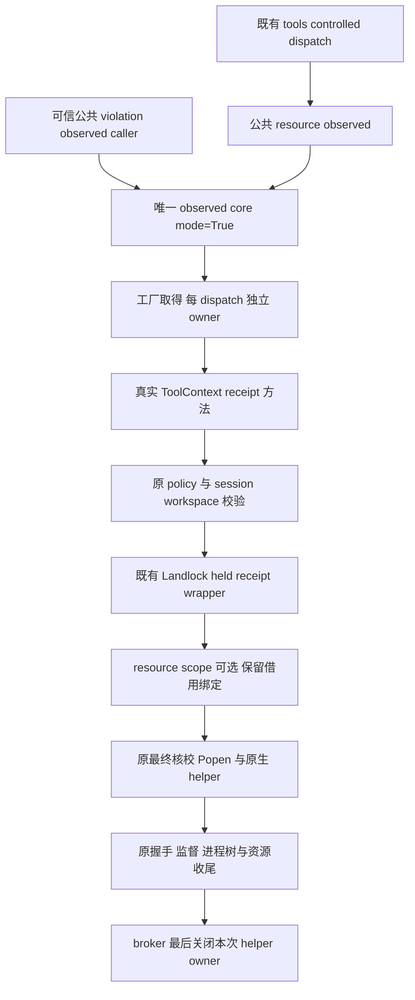
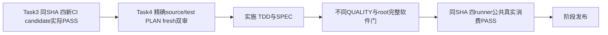

# Linux helper 同对象公共消费设计（Task 4）

状态：提前准备的 DESIGN；未实施、未发布，未执行本设计的测试或原生矩阵。
观察日期：2026-10-12。起草上下文为 main `574033a4df8311a569230bbd0522a0e1be717d8a` 与正在验收的 Task 3 资产；后续实施必须重新冻结实际候选。
Task 3 四个新 CI runner 尚未获得同一 SHA 的实际 PASS，公共合流保持禁止。局部软件或本机安装包结果不能替代此门。
本文使用 nbl.tech-design 的需求、职责、接口、模型与验收结构；Java 模板只作结构参考，本仓库不引入 Java 服务、HTTP、MQ 或 SQL。
用户已委托推荐技术选择自主推进；本文交 root 独立审查，不重复普通技术选择问答，也不启动实施。

## 1. 需求与三问确认

真实问题已确认：Task 2 的唯一 observed core 能取得、借用和回收 helper owner，Task 3 验证的是私有候选。两个现有公共 observed 入口仍未传 `helper_object_mode=True`，因此生产消费缺口仍存在。
现有实现已确认：复用 `open_linux_helper_object`、held receipt wrappers、`PreparedCommand.helper_object`、scope 元数据传播、最终启动核验和完整收尾；不再创建 supervisor 或 owner 工厂。
调用链影响已确认：`tools/builtin.py` 的 `_controlled_dispatch` 将 `ctx.wrap_command_with_resource_receipt` 交给公共资源入口；`ToolContext` 两个 receipt 方法目前不接受 helper keyword。只翻公共开关会以 TypeError 拒绝正常工具。

目标是在 Task 3 四新 CI 门通过后，让两个公共 DENY observed 入口消费同对象 core，同时让真实 ToolContext 保留策略与 session/workspace 绑定并借用本次对象。
信用只覆盖本次 dispatch 核验与实际启动同一 regular 对象；不证明内容封印、发布者认证、动态库可信、祖先可信、模型前 prepare 固定对象、90% 全能力兼容或整体 R2/R3 ready。

### 1.1 推荐方案与拒绝项

| 方案 | 收益与成本 | 决定 |
| --- | --- | --- |
| 两公共入口开已有 mode，ToolContext 显式借用，已知 callback 同步 | 接通唯一监督链；成本为内部 callback 收紧、fixture 修正与四 runner 真实消费复验 | 采纳 |
| 只翻公共开关，不适配 ToolContext | 改动少，但正常工具 callback 不接受 keyword，生产链必拒绝 | 不适配 |
| 捕获 TypeError 后再执行 legacy callback，或另造公共 supervisor | 形成故障降级或重复监督/清理责任，无法保持同对象保证 | 不适配 |

普通 broker、Git、Reviewer、leased-connect 与模型前 prepare 的生命周期扩展暂缓，按独立设计验收。
不改 selector、CLI/MCP、`policy_contract_ready` 或任何政策例外；未知清理不重试，不增加权限、服务、依赖或缓存。

## 2. 已有调用链与责任

源码锚点按当前符号及起草行号记录，实施前按符号重新核对：

| 路径与符号 | 当前行为 | Task 4 责任 |
| --- | --- | --- |
| `src/icode/execution_broker.py:157/169` 两公共 observed 函数 | 同一 core 默认 mode=False；callback 标注仅表达位置参数 | 显式 mode=True；类型表达 keyword callback |
| 同文件 `_execute_linux_observed_command` | mode=True 工厂开 owner，传 keyword，最终核对象并统一收尾 | 直接复用，不复制、不弱化 |
| `src/icode/tools/builtin.py:764` `_controlled_dispatch` | 唯一 src 资源入口 caller，传真实 ctx 方法 | 保持现有接线，验证实际消费 |
| `src/icode/tools/base.py:295/312` 两 receipt 方法 | 先校 ctx policy，再借 session workspace；无 helper keyword | 新增 keyword-only 参数并同引用透传 |
| `scripts/run_native_wheel_ci.py:257` quota closure | 旧位置参数 callback | 接收并转发本次对象 |
| `scripts/probe_installed_linux_helper_object.py` | sandbox closure 直接调用私有 candidate | 保留候选证据，增加公共入口与真实 ToolContext 消费证据 |

无 scope 仍直接启动 helper；resource 仍走 systemd-run scope 第二跳。第一跳 pass_fds 不等价于第二跳实际加载，两个拓扑均须安装包实证。
helper owner 归 broker；session workspace FD 归 WorkspaceSession；channel、scope FD 各归原有组件。ToolContext 只借用，不持久化、不缓存、不关闭 helper 或 session owner。
原生 close_range 的合法保留角色仍为既有 workspace/channels；helper 启动 FD 不增加为 payload 保留角色。若发现必须修改原生行为，返回设计审查，禁止在本片顺带修改 C。

## 3. 内部 callback 与借用合同

两个公共函数的入参形状与 ExecutionResult 返回保持既有形式，不允许 caller 提供任意 owner。公共函数只指定 mode，owner 在唯一 core 的既有作用域取得。
callback 是可信内部适配接口，契约在本阶段收紧；不能宣称任意旧 callback 继续兼容。

| callback | 必须接受的位置参数 | 必须接受的 keyword-only 参数 | 返回合同 |
| --- | --- | --- | --- |
| violation | argv、control_socket | `helper_object: LinuxHelperObject` | 保留 owner 同引用的 PreparedCommand |
| resource | argv、control_socket、resource_socket、unit | `helper_object: LinuxHelperObject` | 保留 owner 同引用、cwd/pass_fds 的 PreparedCommand |

broker 的公共 callback 类型采用 `execution_broker.py` 内两个私有 Protocol：拟定义 `_LinuxViolationCommandWrapper` 与 `_LinuxResourceCommandWrapper`，各自 `__call__` 按上表表达 keyword，不用只含位置参数的 Callable 掩盖约束。
其返回类型可沿已有 `list[str]` 基类标注，运行时仍由 core 严格要求 PreparedCommand 与对象绑定；Protocol 不负责授运行信用，不新增外部 API。
LinuxHelperObject 类型引用按项目延迟标注/类型导入习惯处理，不引入 import 循环。

ToolContext 的两个既有方法仅增加 `*, helper_object: LinuxHelperObject | None = None`；其它位置参数及返回方式不变。
先执行原 `_policy_command_wrapper()` 与 `_workspace_command_options()` 校验，再调用原 sandbox receipt wrapper；read-only Reviewer、错政策、错 ticket、关闭或复用的 workspace FD 仍拒绝。
对象非 None 时用 `helper_object=helper_object` 转发同一引用；不重新取得对象、不从路径重选、不复制或换 owner。
对象为 None 时完全不传这个 keyword，使直接旧调用与无该 keyword 的旧 sandbox receipt 方法继续按原合同工作。
该 None 兼容仅限直接旧 receipt 调用；公共 observed core 总是传入本次对象，不借 None 退回路径模式。
非 None 转发失败，包括旧 callback/sandbox 不支持 keyword，按既有固定隔离拒绝处理。不得捕获 TypeError 后再调用一次，也不得调用普通/裸宿主执行。

每次 dispatch 独立工厂与 owner；同 session 下一命令可再借用同一 workspace FD，前一个 helper owner 已完成关闭。
上下文 `close()` 不扩展 helper 回收责任；borrower 对象不成为持久状态或序列化授权 token。

## 4. 错误、清理与兼容矩阵

结果与异常复用现有 core，不新增错误正文或泄露 helper/manifest 路径。普通异常用现有固定结果；启动/握手后状态不明不能凭包装成功写 payload 已启动。
独立资源全部尝试清理，遵循原顺序和 `_select_cleanup_error`：实际停止/reap、线程/回执、scope/endpoints、最终 helper owner。
KeyboardInterrupt/SystemExit 保持首个信号原对象与既有优先级；普通 cleanup 异常不能遮蔽信号，未知 owner/scope 关闭不能被普通异常掩盖。
scope directory `cleanup_state="confirmed"` 与 cgroup collected 是两种证据，不能互相替代。原同组/全部任务树清理合同保持。

| 情况 | 预期行为 | 所需证据 |
| --- | --- | --- |
| 合法公共 callback 与真实 ctx | 原 DENY/quota 握手完整，执行 held 对象 | 实际镜像身份、payload 正控与回执 |
| 不支持 helper keyword 的旧 callback | 固定拒绝，callback 不二次 legacy 调用，无 payload | 有效 fixture 确认命中 callback，不借缺 manifest 拒绝代签 |
| ctx 错 policy/ticket、Reviewer 或失效 workspace | 继续固定拒绝，不绕过 context 绑定 | 同引用透传正控与各原校验负控 |
| factory/manifest 拒绝 | 未启动，保留既有固定结果，已开资源收尾 | 无 Popen、无 payload、无路径 fallback |
| 绑定缺失、换对象、FD 冲突/复用 | 最终核校拒绝，不关陌生复用 FD | 目标拒绝位确实命中 |
| 启动/observer/resource/CONFIGURED/ACK 故障 | 原结果映射与 incomplete/unknown，清理仍尝试 | 保留 Task 3 原生故障矩阵 |
| timeout/output_limit | 原固定错误，实际树与资源收尾 | 真实 ready 后故障、终态先于 fixture 自清理 |
| helper/scope close unknown | 失败/抛既有异常，不成功、不重试未知 FD | sticky unknown、一次尝试、其余独立资源已尝试 |
| 直接 receipt 调用且 helper=None | 不传新 keyword，原旧 sandbox 形式可用 | 精确无 keyword 的兼容断言 |
| 普通/Git/generic/Windows/Reviewer/leased | 按原流程回归，本片不授同对象信用 | 完整原回归门，Linux mock 不算 Windows native |

private core 默认 mode=False 保留其内部 legacy 回归合同；公共入口切换后不再用公共调用测试“不进工厂”。这不是公共执行的可选降级开关。

## 5. 最小源码与测试集合

后续精准 PLAN 必须冻结 source/test patch 与候选 hash，fresh SPEC→不同 QUALITY 零遗留后才实施。
生产源码范围只需 `src/icode/execution_broker.py` 与 `src/icode/tools/base.py`；`tools/builtin.py` 调用链只读核对并用测试证明，无需改接线。
CI 与真实消费范围为 `scripts/run_native_wheel_ci.py`、`scripts/probe_installed_linux_helper_object.py`；沿现有四 runner/workflow 接线，不增加 runner/权限。
fixture 与回归优先复用下列已有测试文件，不扩散为普通/Git/Reviewer 全入口重构。

| 文件 | 必要变化/检查 |
| --- | --- |
| `tests/test_linux_helper_dispatch.py` | 公共两入口必须工厂、同引用、故障/信号/无 fallback；旧 ordinary unexpected-binding 测试改直接 private core 默认模式；publisher/failure records 回归 |
| `tests/test_linux_workspace_fd.py` | channel collision callback 接 keyword；以真实 regular ELF+manifest 到达目标冲突；真实 ctx resource 正常/timeout 回归；补两 receipt 绑定/None 兼容/跨命令 owner 分账 |
| `tests/test_linux_product_task_quota.py` | 旧 `/not-executed-owned-fixture` 改有效对象 fixture，OwnedScope 明确 cleanup_state=confirmed，让第二 channel 清理信号故障仍实际命中 |
| `tests/test_linux_contract_engineering.py` | 原 native source helper→真实 tools bridge 再验，不以 FakeBackend/model double 授模型信用 |
| 既有 isolation/broker/object/resource/violation/pidns 模块 | 相关 focused 与完整门回归，未变更文件不为凑范围修改 |

有效 RED 是预期行为 assertion FAIL 且 0 ERROR；签名异常、缺 API、无 manifest 或早期拒绝不是本目标的 RED。
软件 fixture 使用真实可核验 regular ELF 与 manifest；假 scope 补清原有 cleanup_state 合同。每个故障测试须断言目标注入点已命中，不允许新前门短路成假 GREEN。
bridge 当前编译 source helper、使用 FakeBackend/model double 且 `native_ready=False`，只授有限 sourcehost/软件消费信用；真实模型与 ready 硬门不改。

### 5.1 实际安装包的新增公共消费证明

Task 3 现有脚本的 sandbox closure/private candidate 证据完整保留，不能仅把私有函数名字替换为公共名字就授生产信用。
扩展同一 installed probe，实际创建 WorkspaceManager/WorkspaceSession，在 session.workspace_root 建 payload；由 session.policy 生成匹配策略，绑定真实 ToolContext 与同一个 session workspace FD/冻结身份。
用两公共入口分别消费 `ctx.wrap_command_with_violation_receipt` 与 `ctx.wrap_command_with_resource_receipt`。
为 payload 注入观测参数的测试 adapter 可以包装真实 ctx 方法，但必须将借用 keyword、原 channels/unit 转给该方法；记录实际 ctx 调用与 same-reference，不能直接绕 ctx 调 sandbox closure。
同 session 至少两次 dispatch，各自 fresh owner；每次结束核 helper EBADF/confirmed、workspace 原 FD/身份仍活，session 最后自行关闭 workspace。
普通 tools resource 消费由真实 `_controlled_dispatch` bridge 与已绑定 ctx 回归另证，不推导 violation 入口自动被 tools 选择。

无 scope 保留真实 ready-before-release 窗口与 Popen PID；scope 保留 authenticated CONFIGURED-before-ACK 和 ready 窗口。
实际 pin proc PID 目录，前后核 starttime/存活/时限，open exe 后 fstat 对 held dev/ino；不可观察记 inconclusive，确证不同对象记 FAIL，两者都不授 PASS。
保留 rename/unlink/replace、decoy 正负区分、payload 首 fstat 前无 open/枚举、初始 FD 身份扫描、workspace capability 不继承、原 DENY/quota 和 GC/cleanup 证据。
保留 Task 3 全部真实故障及受控失败记录：异常终态先于测试自身补救，publish 失败仍保存失败证据，unknown 不伪造全部回收。
公共正控与原 candidate 全故障矩阵可以在同一 probe 内共用夹具；信用标签区分 candidate/public/context，记录对应候选 SHA、包/manifest hash、架构、内核、systemd、拓扑与 dispatch 序号。

## 6. 阶段门与验收

Task 4 DESIGN 可提前准备；Task 3 四新 CI 未过时只审文档，不实施公共改动。所有阶段要求 C0/I0/M0；旧审查、旧 SHA CI、研究或本机通过不能替代新候选。
实施按最小链成对 TDD，focused 通过后 root 运行一次既有完整 preflight（三道守护与 ICODE-SKILL 原契约），另核格式/编译及相关脚本；不以局部通过跳完整门。
四 runner 为 `ubuntu-latest`、`ubuntu-24.04-arm`、`ubuntu-22.04`、`ubuntu-22.04-arm`，每格同一候选 SHA 实际 build/install 后验公共两入口与真实 ctx，无/有 scope 都须 PASS。
记录每个 job、实际命令、包 hash、镜像身份、故障命中、回执与终态；skip/缺环境/inconclusive 均未验收。x64 不替 ARM64，旧 resolver 或 candidate PASS 不替 public consumer PASS。
软件门后按既有发布流程取得用于四 runner 的候选；只有四格公共消费实际 PASS 才记录本阶段发布验收。发布授权不放宽这些门，main 之外不另造分支或远端。
任何 wrapper/scope/ownerfactory/native 必要变更均先设计返审与扩展验证，不能为过门静默加入额外 FD 保存或取消 scope。

## 7. 固定研究复用与取舍

本次只读复核 ICODE 当前 public→core→ToolContext 调用链，并复用 [持续竞品对照](../../agent-landscape-live.md) 的固定机制证据；未声称新 HEAD 或完整 20 项刷新。
Codex 的观察日期为 2026-10-11 20:07 UTC，提交 `27065a91ccbf5ba8532844be3777fcf83b77820d`：[bundled_bwrap.rs](https://github.com/openai/codex/blob/27065a91ccbf5ba8532844be3777fcf83b77820d/codex-rs/linux-sandbox/src/bundled_bwrap.rs)、[exec_util.rs](https://github.com/openai/codex/blob/27065a91ccbf5ba8532844be3777fcf83b77820d/codex-rs/linux-sandbox/src/exec_util.rs)。
systemd 的观察窗口为 2026-10-11 20:30–20:40 UTC，固定 v249 `f6278558da0304ec6b646bb172ce4688c7f162a5` 与 v255 `db11bab38ccf1ed257f310d29070843d4c58ea01`：[v249 path-util.c](https://github.com/systemd/systemd/blob/f6278558da0304ec6b646bb172ce4688c7f162a5/src/basic/path-util.c)、[v255 run.c](https://github.com/systemd/systemd/blob/db11bab38ccf1ed257f310d29070843d4c58ea01/src/run/run.c)。

| 取舍 | ICODE 已有机制、收益与成本 | 许可/安全/兼容与验收 |
| --- | --- | --- |
| 采纳：明确 owner、借用与 procfd 消费 | 已有 factory/held wrapper/core；接通公共消费，成本为 callback 收紧和真实安装包验收 | Codex Apache-2.0 固定观察；无代码复制、新依赖/权限；同引用和实际 exe 核验 |
| 采纳：复用原 scope 第二跳 | 已有 systemd-run scope；避免重复 launcher，成本为发行版/架构实际复验 | systemd LGPL-2.1-or-later 固定观察；源码机制不代替实际补丁版本运行 |
| 暂缓：sealed memfd、全入口与发布者/依赖认证 | 不属于当前公共消费缺口；独立生命周期和信任链成本高 | 不从 held 对象推导内容/加载闭包认证，另片设计 |
| 不适配：可选摘要、全局 owner cache、TypeError legacy 重试 | 违反强制 manifest/每 dispatch owner/固定拒绝 | 测试 bad manifest、旧 callback 拒绝与无 fallback；不复制上游降级 |

研究与实现独立，阶段刷新由 root 汇入 live；本 writer 只新增本设计，未改其它文档。

## 8. 文档自审与交接

作者先按 SPEC 核需求、占位、接口、范围和门，再按 QUALITY 核调用链、错误/兼容矩阵与证据归属；作者自审不能替代 root fresh SPEC→不同 QUALITY。
文档未写可执行伪代码、未提前授公共消费成功；Task 3 当前资产与本片后续修改职责分开，实际实施/测试/四 runner 尚未开始。

【架构级自检报告】（设计文档，不是软件运行验收）

- ✅ 语法/编译：文档结构、表格、图及链接核对；未编译源码，不声称编译通过。
- ✅ 依赖/调用链：两 public→唯一 core→真实 ctx→held wrapper→scope/Popen→native 已定位；旧 quota callback 同步列明。
- ✅ 逻辑/边界：owner 单一、None 直接调用兼容、公共 keyword 收紧、跨命令 workspace 借用与四格门一致。
- ✅ 异常处理：固定拒绝、目标故障命中、首信号原对象及 unknown 不重试要求完整；实际验证后续执行。
- ✅ 关联模块：最小 source/test 集合与旧 fixture/bridge 信用限制明确，普通/Git/Reviewer/leased 无额外授权。
- ✅ 兼容安全：无新权限/依赖/服务，不更改 ready/selector；明确内部公共 callback 有意收紧，不宣称任意旧回调兼容。
- ✅ 可运行性：本轮仅设计与静态自审，未实施、未运行测试/编译或 CI，不报告 100%。
