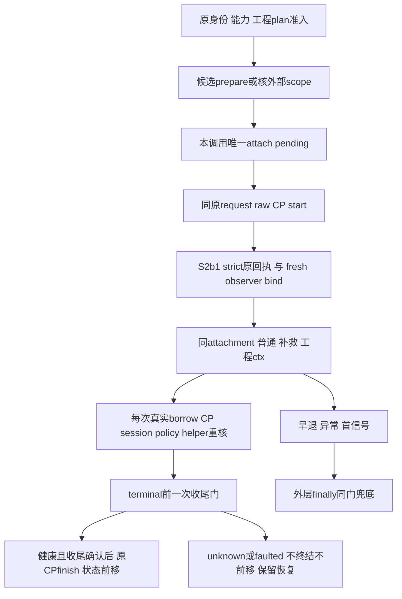

# Linux S2b2：真实 runner 调用内的准备资源生命周期

状态：独立 DESIGN，未实施、未测试、未发布。只准备下一片文档；S2b1 发布前不生成本片 SOURCE/TEST。
观察基线：main `667c92af7b338b9983c9829251a0f70128dd1d8e`；前置为 S2b1 的原始回执与新鲜 CP observer 正式发布。
母合同：[单步准备与消费](./2026-10-12-linux-prepared-step-scope-design.md)、[S2a上下文](./2026-10-12-linux-prepared-tool-context-design.md)、[S2b1控制面](./2026-10-12-linux-prepared-control-attempt-design.md)。

## 1. 三问、范围与复用

真实问题：现有工具能传内部 attachment，但 runner 普通/补救 `_run_agent`、工程检查与终结仍未持有同一次准备绑定；只有外层 finally 会晚于 CP success/transition，造成收尾未确认却已终结的风险。
已有实现：实际 LinuxPreparedStep/attachment 状态机、S2a成对上下文、S2b1原 CLI 回执和每次真实 trace、原唯一 broker、预算与工程验收入口。复用，不新增 owner/supervisor/控制面协议或恢复许可。
调用链已核：run_chain→run_contract_step→普通/补救/工程 ctx→既有 controlled dispatch；纯 admission、只读 Reviewer、恢复及自动 ready 门分别保留边界。三问确认后限定本片。

拟六发布路径：runner.py、chain.py、新 tests/test_linux_prepared_runner_lifecycle.py、本 DESIGN、对应 PLAN、agent-landscape-live.md。scope/control/S2b1适配/tools/engineering实现/autonomy/native/vendor/CI/旧tests只读；后续若事实要求扩大范围，先修订设计和独立审查，不孤立扩源码。
无新用户设置、模型参数、依赖、权限、HTTP/SQL/MQ；技术设计技能的职责/接口/流程适用，Java模板不适配。

## 2. 选择与准入

推荐局部、一次性收尾门：在本调用每个 CP terminal 前确认消费结束及内部 owner 回收，外层 finally 兜底早退/异常。比只移动正常尾段覆盖更完整，不改共享 `_finish_step`、`_stop_contract_for_budget` 或恢复调用的签名。
不适配：sandbox/executor缓存owner、checkpoint还原attachment、cleanup后才改已提交success、准备失败回退旧broker。
暂缓：自动selector/ready、实际安装矩阵、网络、正式doctor/回执及跨step恢复。这些是后续独立验收，不授本片。

`run_contract_step`/`run_chain`拟新增 keyword-only `prepared_scope=None`，仅可信宿主内存 owner；不是模型可传许可。链有非None scope时须真正单步及当前 policy/session/ticket/step身份相符，不靠循环重用；只在非None时给 runner 新keyword。旧None/custom调用形状保持，不新增 autonomy keyword 或捕获 TypeError 重试。
runner非None owner须实际 LinuxPreparedStep，原policy/session同引用、scope仍prepared，真实原身份/能力/工程plan准入成立后才attach。复用scope当前门，不用字段/class通过当授权。
候选自动prepare仅 Linux、实际Landlock、真实live session、合法DENY单根RW policy及实际包内来源匹配。先核现有工程纯admission，随后prepare/attach在首次CP start和模型前；不调用provider探测或生成模型 payload作为准备前置。
来源分类复用包模块对应 native 目录及现有来源坐标：明确不匹配的旧显式非包内来源保留legacy，不授准备信用；包内声明、无法解析的候选或进入准备后的失败均固定拒绝，不能由异常推导“不是包内”后回退。实际 `_source_paths`、打开对象静态/source门仍由工厂完成，不以path相等授执行权。
无session旧实验入口和明确非候选保持原合同且无准备信用；非None scope配None/错policy/session或派生只读策略拒绝。不得删除deny roots以让候选成功。真实 `policy_contract_ready=False` 自动前门不变。

## 3. 调用内流程与上下文

本次栈持有 owner、是否内部创建、attachment、attempt及一次性收尾结果，不能序列化或写checkpoint。非候选None完全不执行新准备行为。
非None路径只调用一次S2b1私有 raw start，沿原确定性request；严格适配所得实际attempt/observer一次绑定view。不得另调用public start、字符串补救或因闭合回放伪造新request/attempt。失败时 pending视图仍必须finish，且尚不调用模型。
普通 `_run_agent`和补救回合同view/attempt；工程两轮 `_contract_engineering_gate`及其真实ctx同view。新增runner私有 `_make_prepared_ctx`仅在本次合法候选分支使用，先核view当前attached_bound、本次实际attempt、真实policy/session同引用及scope门，再成对保存引用；不能只做hasattr/type检查。此准入不borrow、不执行命令、不制造工程证据；真正每次broker borrow仍新鲜CP观察。既有 `_make_ctx` 保持原S2a薄适配语义及精确ToolContext构造shape，不全局收紧空attempt等旧输入，不为旧外部base ctx新增保证。
构造后消费门用runner内私有 `_PreparedToolContext(ToolContext)`，由上述新私有构造入口创建；本次None/resume/Reviewer/pure admission仍用原 `_make_ctx`。子类捕获本次实际view/attempt及原policy/session/sandbox/root引用与坐标，属于可信栈内绑定，不是新caller-ready字段或授权token。不能重新从后来被改写的ctx字段推导预期身份，也不序列化或转移owner。
该子类 `_policy_command_wrapper`在调用原方法前重核捕获绑定与公开字段相等、实际scope current/attached_bound、非readonly及原scope引用门；这是现有 `_controlled_dispatch`在任何observed broker/manager创建前调用的真实入口，也由既有resource包装器再次调用。子类 `wrap_command`固定拒绝prepared上下文的普通包装路线，不调用super/wrap/backend：真实run_command与工程_execute_check在policy漂移None时都先调用此方法，故不能转入legacy payload。合法prepared命令只能沿现有resource controlled dispatch；仅shape完整或子类存在均不授执行权，实际borrow仍唯一获得owner。
`_contract_plan_error`仅纯admission不attach/不消耗scope，原计划/可执行身份门保持。最终工程绑定重核不能遗漏本次prepared绑定；原真实Git/baseline/resource审计合同保持。
Reviewer派生只读策略不获得RW view：独立只读pin/ArtifactBroker/隐藏根不变。`_run_agent`的ctx.close只回收其原ctx所有物，不finish/close外部owner。
恢复 `resume_contract_step`沿当前恢复事实与旧路径，不新增prepared参数/prepare/start，不从history/checkpoint/declaration还原授权；明确不授prepared恢复保证。模型None策略工程legacy路径不改变，若错误混入prepared则在ctx/model前拒绝。

## 4. terminal前收尾门及异常优先级

实际需要守住六个terminal调用点：四个 `_stop_contract_for_budget`（当前1372/1456/1499/1506）、工程失败 `_finish_step`（1500）、正常 `_finish_step`（1515）。正常 `_finalize`（1519）及其CPtransition必须在同收尾确认之后。行号仅基线锚点，实施按符号重新查全调用方。
`return _stop_contract_for_budget(...)`的表达式先执行CPfinish再进入finally；不能以添加finally或只移动正常尾段自称覆盖预算出口。共享budget/finish助手本片不改，调用前显式同一次收尾门，外层finally使用同门兜底。
收尾独立尝试：先view.finish使旧ctx不可借用，再且仅内部创建者scope.close。外部owner不由runner关闭，但消费资格仍永久spent/faulted；内部owner关闭失败unknown不得重试。没有活跃borrow是既有同步broker返回合同，不新增后台waiter。
准备工厂失败沿其原自身回收；prepare成功而attach失败仍回收内部owner。start/绑定失败、模型/工具/补救/工程/post_write/预算/ordinary异常、KI/SE、所有早return均走兜底。finish失败不能阻止内部owner独立close。
收尾门记录本调用已尝试及实际选定错误；后续兜底不得再次close或以成功空操作覆盖未知。只表达当前栈控制，不是caller设定ready/认证token。
scope faulted在finish前后独立核为不健康：finish不抛且保持faulted不等于已恢复。原resource unknown、scope owner unknown或任何收尾未确认使report失败，不调用CPterminal/transition、不clear checkpoint，实际attempt保留open供原恢复。CP成功观察不能洗白faulted；不可另开owner补成功。
第一KI/SE保留原对象；ordinary body不能掩盖cleanup unknown，后续独立close仍尽力尝试。无body时最早cleanup信号保留；普通错误固定不含路径/body。None路径原报告/异常/预算终结语义保持，不以该新错误改全局报告模型。
正常健康消费与内部回收确认后，沿原finish/checkpoint clear/finalize次序；外部owner仍active不是收尾错误，也不授其关闭信用。收尾确认不保证随后CP调用成功，原未确认finish/transition分账保持。

## 5. 有效验收与阶段顺序

DESIGN fresh SPEC→不同QUALITY，完整PLAN同双审；S2b1真实发布后才正式不同TEST作者/root RED→SOURCE作者/root GREEN及限定回归→SOURCE fresh双审→root唯一原完整guard-j1→最终文档/scanner/precise六index→main一次发布。
至少验证真实资源fixture与生产runner入口（模型double信用独立）：prepare/attach早于实际raw start和backend；同owner/view贯穿两次普通命令、补救及两次工程核查；无额外factory；实际CPbind和每次borrow；旧ctx spent/faulted后不能再用。
外部owner第二次相同坐标runner在第二CPstart/模型前拒绝，owner仍外部active；内部owner所有出口EBADF、lease/session仍原创建者持有。wrong引用、source漂移、closedCP/badchain、pending失败均在payload前阻断。
必须直接命中真实run_command和工程_execute_check，而不只调用构造器/dispatch：构造后policy=None、policy合法但换引用、session/sandbox/root/view/attempt漂移、readonly变更、以及同时抹除公开prepared_step/prepared_attempt均拒绝，wrapper/backend/payload与新factory零触达；捕获绑定不能随公开字段抹除而消失。健康实际resource路径仍消费同owner，None legacy ctx原wrap行为不变。子类只是runner内防御，不承诺任意外部自造base ToolContext具备此新合同。
逐一覆盖四预算和两个finish调用前的收尾顺序、post_write/普通返回、KI/SE和compound finish/close、faulted finish静默、unknown不重试；真实CP不可已写success/前移再报告失败。不能仅mock finish调用顺序代替真实CP事件负控。
保持None/custom callback原参数shape、明确非包内与无sessionlegacy、pureadmission无prepare、只读Reviewer无RW借用、恢复不还原许可；自动ready false路径provider/model/start/payload零触达。旧tests不改；若真实旧兼容冲突先报告而非降低新负控。
本片可授有限候选软件生命周期，不能授新installed/native、自动ready、模型六步/90%或R2/R3整体验收。

## 6. 持续研究与设计自检

复用2026-10-12 S2b1实际GET的固定OpenHands SDK3934349da2db0433238621542173a00a8af7439c/MIT与Codex27065a91ccbf5ba8532844be3777fcf83b77820d/Apache-2.0：具体文件、链接和08:18–08:19 UTC观察见S2b1设计第5节。本片独立只读runner盘点不新增远端GET或HEAD刷新。
采纳身份/结果/生命周期分账与消费重新核验；ICODE已有真实view/state/CP，收益是防止退出漏关和早终结，成本为有限runner接线及真实CP/资源/六出口负控，无依赖/权限或源码复制。暂缓缓存、事件恢复、自动准入和原生合流；不适配typed对象、checkpoint字符串或“finally存在”当授权/收尾证明。

【架构级自检报告】（仅DESIGN）

- 语法/编译：实际符号与终结调用点已核，新代码未实施。
- 依赖/调用链：普通/补救/工程及chain成对接线，Reviewer/恢复分界明确。
- 逻辑/边界：候选分类、单调用claim、六terminal前门及sticky faulted分别覆盖。
- 异常处理：首信号与独立finish/内部close、unknown不重试明确。
- 关联模块：六范围，当前S2b1及所有共享scope/vendor/native只读。
- 兼容安全：旧None/custom/resume/ready合同保持，不新增权限或用户开关。
- 可运行性：设计未测试；独立双审、正式TDD及真实矩阵均待，不报告100%。

设计审查历史：初稿5ddc0aec fresh SPEC为C0/I1/M0，指出只有_make_ctx构造门未封闭实际普通工具/工程policy=None字段漂移；本次明确runner私有context两条实际消费门及同时抹除字段负控，保持六范围和旧base/工具/工程只读。仍须fresh复审，不以文档修正预授已实现。
复审f08c75bf仍C0/I1/M0：消费漂移门已设计闭合，但直接改变原_make_ctx与既有S2a旧测试（包括None/空attempt及patched ToolContext精确kwargs）冲突。当前改新_make_prepared_ctx仅候选调用承担严格验证，原_make_ctx不改合同；新增负控与旧薄适配回归并列，继续独立复审，既有测试不为方便而修改。
