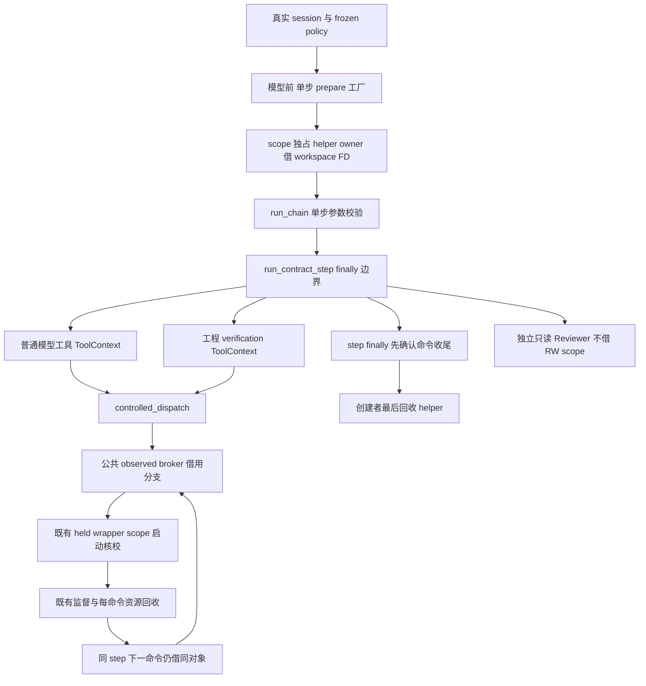

# LA-2：Linux 单步准备对象与真实命令消费

状态：DESIGN，未实施、未测试、未发布；不表示 LA-2 或 R2/R3 验收完成。
观察日期：2026-10-12；源码基线 main `1c44aa09f1660929d0b6b8e63bf1952deed6f6e3`。
用户已委托常规推荐方案自主推进；本文仅提交独立设计审查，不自行生成实施计划或修改源码。
母合同：[Linux 准入分片](./2026-10-12-linux-admission-receipt-design.md)、[R2 威胁模型与十项门](./2026-09-23-r2-cross-platform-isolation-design.md)。

## 1. 需求、现状与三问

真实问题：当前 `LandlockSandbox.prepare_policy` 只核策略子集和路径摘要；模型调用之后，公共 observed broker 才重新取得 helper owner。
已有同对象 dispatch 不等于“模型前固定对象、同一步消费”。prepare 与执行之间仍没有明确的宿主资源生命周期。
复用实现：`LinuxHelperObject` 工厂、`PreparedCommand`、真实 session 目录 FD、两公共 observed 入口、唯一监督 core 与 resource scope。
调用链影响：限定可信 Python 内部参数传递，不改变工单状态机、控制面协议或模型工具参数。
三问均已确认；不另建 supervisor，不用诊断分数解决生命周期问题。

| 当前事实 | 本片关闭的缺口 | 仍不授予 |
| --- | --- | --- |
| `prepare_policy` 无返回 owner | step 开始前取得并持有实际包内对象 | publisher、内容不可变、已控制宿主同 UID 防御 |
| broker 每 dispatch 开关 owner | 同 step 顺序借用准备对象，创建者最后唯一回收 | 跨 step、跨工单、并发命令复用 |
| chain 已传真实 policy/session | 普通工具及宿主工程检查同时消费同一准备绑定 | 只测对象就称产品接线完成 |
| selector 无 Landlock，ready 固定 False | 内部候选调用链与自动前门分别实证 | 自动选择、保护已启用、整体准入通过 |

范围仅当前已能表达的 DENY、单一代码读写根、合法 live WorkspaceSession。
继续拒绝真实 nested-deny、任意读取根、代理网络和派生只读 Reviewer 策略，不删除受保护路径换取通过。
技术设计技能的职责、流程、接口和对象结构适用；Java/Spring、SQL、HTTP/MQ 模板不适用，本片不增加框架或数据库。

## 2. 方案取舍

| 方案 | 收益与成本 | 结论 |
| --- | --- | --- |
| A：有限单步 scope，复用唯一 observed core 的借用分支 | 明确 prepare→consume→finally；需要成对参数接线、加载前置及真实安装包负控 | 推荐 |
| B：将 owner 缓存在 sandbox/executor/doctor 中 | 少传参数，但生命周期跨步骤、来源和旧缓存混淆，未知关闭易被隐藏 | 不适配 |
| C：一次实现密封镜像、发布者信任、网络、正式回执和自动 selector | 更大保证，但不属于当前缺口，重复扩大审计与兼容成本 | 暂缓，独立设计 |

准备对象不承担授权评分；没有 caller-ready bool、模型 token、磁盘 PASS、时间有效期或可反序列化许可。
本片只建立有限候选消费合同，母设计 LA-2 的“实际包内后端自动准入”仍待后续条件齐备。

## 3. 架构与真实入口

自动 `NativeChainExecutor.execute` 的现有 ready 前门仍在模型、provider 和 step start 前阻断 Landlock。
不能新增一个被 ready 门永久挡住的分支，然后仅用 mocked-ready 测试声称产品合流。
候选接线必须在实际 `run_chain`/`run_contract_step` 内部入口可执行；它们目前能直接接收显式 sandbox/policy/session。
该入口不是新增面向用户的自动模式、CLI 参数或绕过开关；只证明内部生产代码组件真实消费，信用标签固定候选。
自动 executor 后续接线必须复用同一个 prepare/consume 实现，而不是复制内部候选路径。

| 已有符号 | 设计职责与关联检查 |
| --- | --- |
| `autonomy.NativeChainExecutor.execute` | 保留所有前门；后续正式准入成立时才负责 step prepare/finally，不给 custom step_runner 新 keyword |
| `chain.run_chain` | 限单步、核 policy/step/ticket/session；接收宿主准备 scope，不得跨循环重用 |
| `runner.run_contract_step` | 内部候选无传入 scope 时在首次模型调用前取得；通过真实前置门后一次attach本次调用、绑定CP attempt，finally结束消费资格 |
| `runner._run_agent`（2395–2444）、`_make_ctx` | 常规与本次调用内补救回合都传同一次attachment；构造ctx核实际step/attempt绑定，不放模型history/checkpoint |
| `runner._contract_plan_error` | 原 verification-plan 身份门保留；若执行检查需准备 scope，核借用绑定，纯 admission 不制造 execution 证据 |
| `runner._contract_engineering_gate` | 工程验证 ctx 接同 scope；所有 verification checks 通过已有 `_controlled_dispatch`，不得重新开 helper |
| `engineering_verification._execute_check` | 保留工具 identity、cache、超时/输出/资源证据原合同，复用真实 ctx，不添加旁路 |
| `tools.base.ToolContext`、`tools.builtin._controlled_dispatch` | 保存借用引用并在 dispatch 前重核；将其传至公共资源 observed 入口 |
| 公共 violation observed 入口 | 可信内部 caller 可借同 scope；没有常规 tools 自动选择该入口的额外声明 |
| `runner._run_task_reviewer` 与 review step | 派生只读策略不借 RW scope；保留 read-only pin、ArtifactBroker、隐藏根和拒绝命令行为 |
| ordinary broker、Git/status、leased-connect | 不接新准备对象；Git 自有资格与 pin 不变，网络合流留 LA-3 |

实施必须按符号全局查调用方，包括 admission helper 再建 ctx 的支路；不能只给 `run_command` 添参数。
code/deepcheck 的工程复核、失败后的清理和 Reviewer 必须分别实证；普通主循环结束不等于整个 step 已结束。

## 4. 内部 API 与对象模型（拟新增，不是现有 API）

拟设内部模块 `linux_prepared_step.py`，由可信宿主代码调用，不加入 registry 或公开包接口。
`prepare_linux_step(sandbox, *, policy, workspace_session)` 返回 `LinuxPreparedStep`；没有 helper 路径、expected hash、ready 或 caller 身份 override。
工厂读取实际包内 resolver 的来源，与显式 sandbox 所指 helper/manifest 核相等并取得真实 owner；显式任意路径不能获得该合同。
来源相等只是前置，真正摘要/架构核验仍用打开对象工厂；不把 `LandlockSandbox.from_bundle()` 构造成功当授权。
保留旧 `prepare_policy(policy) -> None` 语义；新工厂调用原策略子集门，不让所有旧 backend 改返回类型。
runner自动准备仅限定实际包内来源匹配、真实live session、合法DENY RW policy的内部候选；review/派生只读ctx不进入此分支。
旧显式非包内source helper、无session实验入口保留原合同且无新准备信用；传入scope或已进入包内准备分支后的失败，绝不退到旧路径。

| scope 内存字段 | 来源及消费规则 |
| --- | --- |
| 实际 session 引用、ticket/run/step | 宿主 session 与实际 frozen policy；构造及每次消费核一致，不接受 dict/SimpleNamespace 替代 |
| policy 引用、canonical policy hash | 现有 `SandboxPolicy.policy_hash`；消费重算并核字段，合法但不同政策对象不静默复用 |
| workspace root、FD 整数与 dev/ino | session 原 owner；实际 fstat 为目录，FD≥3，身份、原引用、路径 no-follow 对象一致 |
| helper owner、architecture、digest、dev/ino | 真实 factory 同 FD观察；scope 独占 owner，不转移或复制、不序列化 |
| owner生命周期 | active/closed/unknown；只表达回收状态，不是外部可设的认证标志 |
| 调用attachment与消费状态 | prepared→attached_pending→attached_bound→spent；独立资源未知清理时进入sticky faulted；实际runner调用内一次claim、实际CP attempt绑定，单个in-flight借用 |

仅验证 class/构造器字段不是来源认证；准备 factory 与真实对象核验不可跳过。
session 的 lease `_stream` 必须仍存在、未关闭且真实锁文件身份检查通过；不得重新加锁作为失效会话的修复。
若需安全读取 lease 活性，提供 workspace 内最小只读校验方法，复用原 `_validate_lock_file_identity`，不暴露 stream、不改变释放责任。
scope 不拥有 lease/workspace FD，不关闭它们；宿主禁止外部 close/dup2 或并发变更 owned helper/session。
当前 owner 不能完全识别同对象 FD 数字复用，设计不宣称消除该可信宿主误用。

同一ticket/run/step/session/policy不代表同一次调用：`run_contract_step`每次会调用真实`cp.step_start`（当前1319–1326）产生本次attempt，准备对象禁止跨该边界复用。
拟设内部一次attach：runner先完成原身份/能力/CP前置校验，不在不可达ready前门或纯admission检查消耗scope；随后原子地将prepared对象claim到本次真实runner栈帧，返回仅本次调用持有的内部attachment借用视图。
该claim不接caller随机token或caller提供attempt；调用身份来自runner本次栈内事实，class、随机值或typed视图本身均不认证执行权。第二次runner调用不能复用已有attachment或重新claim同scope，即使所有命名身份相同。
实际`cp.step_start`返回合法attempt后，runner将该值一次绑定attachment，并核原CP确认；失败/空attempt不得造证据、不得调用模型或payload。正式borrow仅允许attached_bound。
ToolContext与本次普通/补救`_run_agent`、工程verification持同attachment引用；构造ctx核该视图仍属本次调用及实际step/attempt。准入检查只读核绑定，不attach、不重新生成attempt。
公共observed的`prepared_step`参数消费这个内部attachment视图，不接受未attach的原始owner scope；视图进入borrow上下文时重核scope/session/policy、实际helper fileno与本次attempt，再取得排他借用。
同时或重入借用拒绝；单命令退出只释放借用状态，不关闭helper、不结束整个attachment。本次调用内补救回合及顺序工程checks可继续消费同attachment。
runner finally无论返回、异常、取消或KI/SE都结束消费资格：正常消费状态置spent，已有faulted保持faulted；先完成正在借用命令的原清理，再使旧ctx/视图不可再借用。即使外部owner还active且未close，消费资格也不能恢复prepared或再次attach。
attached_pending时尚未产生attempt的退出同样置spent；首次prepare或attach前的前置拒绝不写CP attempt、不制造step事件，内部已取得owner仍按原创建者finally收尾。
任一命令独立资源cleanup unknown，由broker在释放borrow前将scope消费状态置sticky faulted，使整个attachment立即不可继续消费；borrow finally只释放in-flight，不清除faulted，runner finally也不得将其恢复可用。
faulted不等于helper owner自身关闭unknown：broker仍不关helper，若helper owner仍active，创建者finally仍唯一尝试helper close；helper close若unknown另记，不允许以消费失效为由漏关或重试。
首信号原对象与全独立资源尽力清理优先级不变；不能用新CP attempt、旧视图或再次attach恢复faulted scope。
每命令仍独立拥有channels、monitor、task scope、接收线程及进程；owner关闭责任不因attachment invalidation转移。
scope `close()` 只在没有活跃借用时一次尝试 helper close；确认关闭后重复调用无副作用，unknown 不再试、不因下一步重新工厂补成功。
拒绝 copy/deepcopy/pickle；无 executor 字段缓存、全局集合、磁盘缓存或跨工单再用。

拟给两公共 observed 函数新增 keyword-only `prepared_step=None, workspace_session=None`；由唯一 core 增加显式 owning/borrowing 分支。
None：保留当前每 dispatch factory owner 与最终 close，既有调用方行为不变。
非 None：在资源创建前核本次attached_bound视图并取得scope借用，使用其中同一helper，不再次factory；finally回收该命令资源并释放借用，绝不close helper。
借用验证必须包含真实 caller session；由 ToolContext 的宿主适配调用传入，不能只靠参数中的 policy 自证。
`_controlled_dispatch` 仅当ctx有prepared_step才成对传两个keyword，session取ctx.workspace_session；无scope完全不传新keyword，保持旧callback参数形状。
手动violation caller也必须明确传当前真实session；非None scope配None/错session固定拒绝，不从scope自己反取预期session充当caller事实。
scope 和一个任意 `helper_object` 不能同时当外部输入；公共参数只接准备 scope，底层 wrapper 继续收到同一 owner keyword。
最终 `_check_held_helper_launch` 与 scope 第二跳 metadata 核验保持，prepared wrapper 仍须 same-reference；任何错误不回退 None。

## 5. 加载与来源前置：有限静态核验

原 R2 不防已经控制宿主的同 UID 程序；不是以内容密封、防 root 攻击为目标。
但恶意项目不能在助手建立限制之前控制其 loader 或写入 helper 来源，这必须实际核验，不能靠“setup 用了 -static”推导。
当前 factory 的 64 字节 ELF 头只核架构，允许 ET_DYN；未证明 PT_INTERP/DT_NEEDED 或实际动态加载闭包。
当前 `_policy_environment` 显式白名单没有 LD_PRELOAD/LD_LIBRARY_PATH；原生 close_range 只保留合法 channels/workspace，helper 启动 FD 不传 payload。

最小前置分两项，实施 PLAN 必须先完成，不用外部 `readelf` 作为运行时依赖：

1. 对 factory 已持的同一 FD 有界解析 ELF64LE program-header 表：沿当前64 MiB文件限额；本片收紧为随包 ET_EXEC、条目尺寸56字节、计数1–1024。拒绝越界、扩展计数、截断或读取漂移；要求无 PT_INTERP、无 PT_DYNAMIC。这是当前 `-static` 包产物的更窄合同，不是泛ELF静态认证；静态PIE也可能有PT_DYNAMIC，暂不支持该格式，不能因其“可能静态”放行。
2. 实际包内 helper/manifest 的规范来源不得与 policy write_roots 相交；有限检查来源自身及祖先链接/目录身份，确保路径映射没有把安装包目录带入项目可写边界。来源可以位于合法运行时只读映射（包括正常pipx包目录），但须核既有实际映射不会给其写权；不将可写工作区内venv当安全来源。显式此类安装保持旧候选行为但拒绝新scope。准备及首次/每次借用重核来源边界和同FD身份，不重开替代镜像。

**严格runtime解析契约补充（2026-10-12，S0b Task2R设计返审，未实施/未验收）：** S0b本机故障矩阵实测非严格 `Path.resolve()` 的home/prefix/baseprefix辅助解析吞9个OSError，来源wrapper未能固定拒绝。最小修复仅为 `LandlockSandbox._validated_runtime_roots(prefixes, *, strict=False)`、`_runtime_read_roots(*, strict=False)`、`_checked_policy_workspace(policy, *, strict_runtime=False)` 新增默认False私有模式。新source明确opt-in严格True，home与两个Python prefix使用 `resolve(strict=True)`；异常继续向source原固定错误/首信号包装传播。默认分支保持原无keyword调用形状与行为，不复制policy gate、不全局猴补Path、不重试旧callback、不改变ready或运行时read roots授权。此项只闭合新来源观察的解析unknown拒绝，source canonical路径预算不扩成runtime完整遍历预算；不授多用户宿主安全、installed或LA-2信用。具体有效assertion RED、两个旧默认callback测试、逐lstat故障与实际失败基线见 [S0b PLAN](../plans/2026-10-12-linux-helper-source-boundary.md)；修订先独立SPEC→不同QUALITY再实施，原9失败保留，不降预期。

有限读取用同 FD 的显式 offset读取（如 `os.pread`），不移动共享 file offset；缺机制拒绝，不并行修改 owner 状态。
解析前后 fstat 核 dev/ino、size、mtime_ns/ctime_ns；同时按原64 KiB块限再次核全文摘要等于owner.sha256，避免factory结束与解析开始之间漂移未被绑定。
header/table读取总量不超过64 KiB+64字节，全文摘要读取不超过64 MiB+1字节；整数offset/length先核落在真实文件长度内，不接受bool、溢出或短读完成。
完整读取前后snapshot不一致、EOF不符或摘要变化固定拒绝；这不是持续内容密封/ABA防御，也不把合法rename后的ctime变化等同inode变化。
解析不拥有额外binary FD；失败由scope创建者唯一收尾，已取得owner只尝试close一次。source祖先检查若开目录FD，全部由该检查拥有并独立一次关闭，unknown也不得授准备成功。

这里只防项目受限执行面的来源写入与前限制 loader 注入，不承诺宿主安装目录不可被同 UID 修改、publisher 认证或持续内容封印。
rename/unlink 后持有对象仍可消费；路径替换不得使下次借用选择新对象，若来源边界已无法核验则阻断，而非退回路径执行。
取得 helper 后解析失败仍由工厂/创建者尝试关闭，不吞 unknown；解析不能借关闭 workspace/channel 补偿。
root 对本机旧 installed artifact 的 readelf 观察为 ET_EXEC、10个 program headers、无 INTERP/无 dynamic section；仅该 artifact，不授四 CI 格静态证明。
若实际包、解释器布局或 systemd 第二跳不能满足上述有限门，应返回独立加载/来源 slice 设计，不顺带加服务、密封或扩权。

## 6. 收尾、错误与兼容

step 创建者的 finally 覆盖模型异常、预算耗尽、工具/verification 失败、post_write/Reviewer/CP gate 失败和停止信号。
runner 自己创建则自己关闭；宿主传入则宿主关闭。chain、ToolContext、broker 只是借用，不能每层再 close。
runner无论是否owner创建者都负责一次attachment结束；结束消费资格与关闭FD两件事分开，外部创建者仍须关闭spent scope的owner。
必须先结束当前真实命令/线程/channel/resource scope，再释放借用，最后 step owner 关闭；不能为关 helper 跳过其它独立资源清理。
普通 body 失败不能掩盖 helper/scope cleanup unknown；首个 KI/SE 保持原对象，普通 cleanup 不能遮蔽信号，其余独立清理仍尝试。
沿现有 `_select_cleanup_error`/helper 固定错误优先级；新准备错误使用固定输入无关码，不输出路径、FD、policy 正文或异常正文。
cleanup 状态 unknown 保持阻断，不再 close 可能复用的整数、不再启动下一命令或下一 step；确认 body 结果不等于确认清理。

| 兼容场景 | 本片要求 |
| --- | --- |
| bwrap/container/seatbelt/Windows/NoIsolation | 不传新 keyword、不改原 prepare/wrap 返回；NoIsolation 自动前门继续拒绝 |
| custom step_runner | 保持原签名与传参；不创建它不能消费的 scope，不捕获 TypeError 重试 |
| 显式旧 Landlock wrapper/公共 observed 无 scope | 原 path/每 dispatch owner 合同保留，但不授模型前准备信用 |
| 同 step 多工具/多 verification checks | 顺序借同 owner；单命令终态 helper仍活、workspace仍活；step最终唯一关闭 |
| 同名step新runner调用/新CP attempt | 旧scope/attachment不可attach或借用；需新prepare对象，不能用同session/hash证明复用合法 |
| policy/session/run/ticket/step/目录 FD漂移 | 执行前固定拒绝，无 factory替换/路径fallback/裸执行 |
| Reviewer 派生只读与最终 review | 不复用 RW准备对象；原命令拒绝及宿主 artifact/read-only pin不扩大 |
| leased-connect/代理许可 | 新 scope拒绝；LA-3 单独闭合资源/USER_NOTIF/会话，不混授 |

## 7. 实施分片与实证门

每片 DESIGN→精确 PLAN→有效 assertion RED→GREEN→fresh SPEC→不同 QUALITY；root 统一冻结后一次原完整 preflight。
当前文件仅 DESIGN，自审不替代独立审查，也不提前记录测试通过。

| 顺序 | 必须交付的证据 | 不授信用 |
| --- | --- | --- |
| S0 静态加载/来源有限前置 | 同 FD表读取及边界负控；实际 installed helper无INTERP/DYNAMIC；原环境/FD关闭回归 | 构建flag或合成ELF头不算安装包 |
| S1 准备对象与借用 broker | 真session、policy hash、活lease/FD、同owner；owning/borrowing cleanup与信号/unknown矩阵 | 只测capsule不算产品接线 |
| S2 内部真实接线 | 实际 run_chain→run_contract_step→普通工具与工程 verification 同引用，首次模型前prepare；异常各finally | mock-ready/custom runner 不算自动生产 |
| S3 安装包候选消费 | 同候选 SHA 四Linux runner实际build/install，内部链、无/有scope、两公共入口、prepare窗口对象变化负控 | 旧dispatch84条或source编译helper不替新信用 |
| 后续 LA-2正式准入 | 自动选择与独立真实能力门设计/实测成立后，NativeChainExecutor实际消费同实现 | 本片不翻ready、不开自动模式 |

S2 正控使用真实 WorkspaceManager/Session、原 CP 工单事件、frozen policy、真实包内 helper 和实际 tools/verification入口。
可用模型 double 决定工具顺序；必须明确不是模型质量/KEY/六步真实性信用。断言prepare先于第一次backend调用、step event与payload。
至少同一次runner调用两个普通命令、本次`_run_agent`补救回合加实际工程检查，确认没有再factory，两个工程检查顺序借用；失败/取消时后续检查不运行。
单列目标负控：外部owner在首次runner返回后故意保持active，第二次同ticket/run/step/session/policy调用仍拒绝已有scope，不产生第二CP step_start/模型/payload；仅helper已close或错policy造成早拒不算目标命中。
另外实证attached_pending未获attempt退出、CP start失败/普通异常/KI/SE、命令cleanupunknown均终结消费资格；旧attachment/ctx无法继续借用，而外部owner最终仍由外部创建者一次关闭。
Reviewer 不借scope且既有只读/hidden-root负控不扩大；完整工程最终检查债务不因准备对象存在而自动满足。
另跑真实 NativeChainExecutor ready=False负控：provider、模型、step start与payload均未调用，原拒绝码保持。
自动生产合流不能在 S2 记完成；待母合同后续正式准入取得真实 backend/selector 证据，再单列自动入口installed复验。

S3 保留真实 CONFIGURED-before-ACK、ready窗口、proc PID目录/starttime/实际exe devino与held身份核验。
在prepare后模型前/模型等待期对path rename、unlink、replace；实际执行只能同held对象或按前置明确拒绝，不选择decoy。
终态先于测试自身补救；helper最终EBADF/confirmed、每命令scope/线程/channel/进程终态、workspace仍活后session自行关闭分账。
负控命中目标：wrong session/hash/step、closed/reusedFD、重入借用、坏静态表/动态helper、来源可写、wrapper换owner、launch/observer/ACK故障及各closeunknown。
故障早期被其它门拒绝不能算目标通过；skip、缺manager、观察不足/inconclusive与unknown均不授PASS。
四 runner 是 ubuntu-latest、ubuntu-24.04-arm、ubuntu-22.04、ubuntu-22.04-arm；同SHA实际包/manifest/hash/内核/systemd及拓扑均登记。
原§14.1八关键项与≥9/10、LA-3网络、LA-4持久回执/doctor/UI、CLI/MCP、Windows/macOS、R3模型/90%分别继续验收。

## 8. 研究与设计自检

复用本轮独立只读研究的固定提交：Codex `27065a91ccbf5ba8532844be3777fcf83b77820d`，OpenHands SDK `3934349da2db0433238621542173a00a8af7439c`；不是最新HEAD或完整20项刷新。
本轮独立观察自2026-10-11 23:48:32 UTC起，实际取固定bundled_bwrap/LocalWorkspace及两根LICENSE；exec_util只复用2026-10-11 23:00–23:02 UTC已核固定观察，不假称本轮重取。
Codex [bundled_bwrap.rs](https://github.com/openai/codex/blob/27065a91ccbf5ba8532844be3777fcf83b77820d/codex-rs/linux-sandbox/src/bundled_bwrap.rs) 的打开对象摘要与procfd消费分层、[exec_util.rs](https://github.com/openai/codex/blob/27065a91ccbf5ba8532844be3777fcf83b77820d/codex-rs/linux-sandbox/src/exec_util.rs) 的生命周期机制只作借鉴；不把另一对象的上游行为代替ICODE实证。
OpenHands [LocalWorkspace](https://github.com/OpenHands/software-agent-sdk/blob/3934349da2db0433238621542173a00a8af7439c/openhands-sdk/openhands/sdk/workspace/local.py) 的结果/执行边界不等于本机隔离授权；本项目继续核真实OS对象。
许可为已核 Codex Apache-2.0、OpenHands MIT，无代码复制、依赖或权限新增；成本为内部scope接线和安装包复验。
采纳：明确owner/borrow和环境绑定；暂缓：密封、全动态库信任与独立准入；不适配：直接宿主Popen、可选摘要、全局cache或typed对象自证授权。
研究记录已与[持续对照](../../agent-landscape-live.md)本轮LA-2条目核对；本 writer未修改其它文档。

作者已按需求、占位、范围、接口、调用链与信用一致性自审；root独立 SPEC→不同 QUALITY 后才准生成 PLAN。
首轮fresh SPEC指出同名step跨runner调用重用及不存在的loop符号；本修订增加一次真实调用attach、CP attempt绑定和finally失效，改为真实`_run_agent`常规/补救支路。修订正文SHA256 `156f1c0ccb962196e65e03b2c7ebdf0bdf785693ab364ba209199e686c35cf33` 经独立SPEC复审及不同代理QUALITY均为C0/I0/M0；root已全文读取并核对。这仅授进入精确PLAN，不授实施、installed、自动模式或LA-2验收信用。

【架构级自检报告】（设计文档）

- 语法/编译：文档结构、真实符号与流程已核；未编译源码，不报告编译通过。
- 依赖/调用链：普通工具、工程verification、admission重复ctx、Reviewer及custom runner均列明。
- 逻辑/边界：单步顺序借用、真实session/hash/FD绑定、静态前置和自动前门信用分开。
- 异常处理：唯一创建者finally、独立资源尽力清理、首信号与unknown不重试明确；尚未实测。
- 关联模块：不改变CP状态机/vendor/Git资格，来源和lease最小核验需后续精确计划。
- 兼容安全：无新权限/服务/依赖，旧后端参数不扩散；新scope内部合同必须成对接线。
- 可运行性：仅设计与静态自审，未实施/测试/CI，不报告100%或LA-2完成。

实施进度（2026-10-12 01:37:38 UTC）：S0b来源观察及三私有strict配对修复取得fresh SPEC→不同QUALITY零遗留、125关联测试和531故障通过；root原完整预检三道exit0。此为有限软件子项，不改本设计的S1–S3、installed/ready及LA-2整体验收门；历史“未实施”自审描述保留其设计时点。
