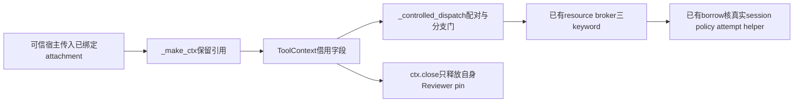

# Linux S2a：准备对象的工具上下文薄适配

状态：独立 DESIGN，未实施、未正式测试、未发布。当前B2完整预检进行中，B2源码/测试冻结；本设计不属于B2五路径发布。
母合同：[单步准备对象](./2026-10-12-linux-prepared-step-scope-design.md)。观察日期2026-10-12，当前main80f36ec；未来实施前须核当时实际main及下述源码字节，不猜B2提交SHA。

## 1. 需求与三问

真实缺口：生产`ToolContext`及`_make_ctx`没有准备对象借用引用，`_controlled_dispatch`没有把已有broker的三keyword配对传递；母合同S2尚未真实接线。已有实现：S1 attachment、真实session/lease/FD绑定、S1c公共resource broker及唯一borrow core。不重新实现owner、授权、helper factory或资源监督。影响仅可信宿主context到已有执行入口，模型工具schema、工单状态机和控制面不改；三问已确认。

本片先闭合薄适配，再由独立S2b接runner创建、真实CP attempt与finally，S2c验证生产链。只完成适配不能宣称模型前prepare、真实CP确认、自动准入或R2/R3完成。

源码基线SHA256：

| 文件 | 当前字节 |
| --- | --- |
| `src/icode/tools/base.py` | `9515d0beb02ec45c752fb5f2aaa7e7d923e86403f285ba5b0897518e08cc6833` |
| `src/icode/tools/builtin.py` | `12cfa163a9fa61f1a762c6f3cd87edd83d34e28b9a6e4a2b993954ffbbac637d` |
| `src/icode/runner.py` | `5477acc209e82cf25687de37cb6690095bb3c7631ea2e569d6ea21ca7fad8e5c` |

## 2. 职责与流程

上下文只持借用引用，无权attach/bind/finish/close准备对象。`ctx.close()`保持原义，否则普通模型回合结束会提前消耗补救和工程检查资格。实际执行授权仍由已有broker/borrow验证；字段、类型、固定软件validator与转发成功本身均不授执行权。

## 3. 最小私有接口

`ToolContext`在现有最后init字段`allowed_read_files`之后增加`prepared_step`和`prepared_attempt`，使用`field(default=None, kw_only=True, repr=False)`。保留旧11个positional参数顺序/含义，不把整个dataclass改成keyword-only，不新增模型参数、持久化或history/checkpoint字段。注解的Linux attachment仅TYPE_CHECKING导入；非Linux模块仍可正常导入。

`_make_ctx`仅增加两个可选keyword，保留引用。全None时不向`ToolContext(...)`塞新增kwargs，保持旧constructor callback形状。非None输入明确转发；不创建owner或调用attach/bind，不从scope反取caller session。当前runner调用点不改，由下一片负责完整真实CP生命周期。

`_controlled_dispatch`在其内部任何wrapper/observed/ordinary broker调用之前核配对与适用分支。已有cwd/policy、require_resource、cache及wrapper绑定门不放宽。只有完整且合法的非None借用形状才向已有resource入口一次传入：`prepared_step=ctx.prepared_step`、`workspace_session=ctx.workspace_session`、`prepared_attempt=ctx.prepared_attempt`。三个均保留原引用/值。

前置门只做薄适配，不在context提前进入一次borrow再交broker，不复制scope._check状态机；真实活lease/session/helper/attempt和消费资格仍由唯一broker.borrow核。固定拒绝使用既有`IsolationUnavailable`输入无关提示，不输出FD、路径或异常正文，不捕获TypeError退回旧调用。

下表仅描述实际进入`_controlled_dispatch`的调用，不承诺所有任意可变context消费入口都已接此门。

| 输入 | dispatch内部行为 |
| --- | --- |
| attachment与attempt均None | 原路径，resource/ordinary均不增加三个keyword |
| 无attachment但任意非None attempt（包括空串） | 固定拒绝，不静默转旧owning分支 |
| attachment存在但attempt非str、空白或控制字符 | 固定拒绝 |
| attachment存在但session缺失 | 固定拒绝，不从view反取预期session |
| raw scope、普通object或非现有内部attachment类型 | 固定拒绝 |
| Reviewer/read_only或非Linux resource分支携带attachment | 固定拒绝，不走只读wrapper或ordinary fallback |
| 构造后字段漂移为以上任意形态 | dispatch重新核验，不仅依赖构造时检查 |
| 形状完整但真实identity/attempt/消费资格不符 | 由实际broker.borrow拒绝，不重开helper、不fallback |

本片不承诺context构造即完整验证CP。现有`run_command`在policy=None时走`ctx.wrap_command`，`engineering_verification._execute_check`在policy=None时走旧bounded-output，两者不经过上述门；这些legacy入口既不新增保证，也不能授准备对象消费信用。S2b必须在真实runner的context创建及消费前置门保持完整policy/session/attempt绑定，单列无policy、Reviewer、resume及字段漂移的实际工具/工程入口负控，再决定是否需要统一入口适配。不能把本片的直接dispatch测试推广为这些未接入口已阻断。

## 4. 验收与范围

七路径：上述三个源码、一个新`tests/test_linux_prepared_tool_context.py`、本DESIGN、配套PLAN、`docs/agent-landscape-live.md`。旧tests、scope/attachment/broker/native/vendor/CI和母设计只读。runner只允许`_make_ctx`局部，不改invocation、`_run_agent`、工程gate、Reviewer、resume或automatic ready。

先独立DESIGN SPEC与不同QUALITY，再完整PLAN双审；不同作者TEST ONLY有效RED、root独立重复，然后不同SOURCE作者最小差分。缺字段/参数时用signature-aware或现有实例测试字段命中真实转发/拒绝断言；constructor TypeError不算有效RED。

至少覆盖：旧11 positional完整映射、新两字段keyword-only；_make_ctx同引用且不factory/attach/bind；全None resource/ordinary精确kwargs含output/cache已有规则；合法view三个keyword完整且ordinary零调用；实际直接dispatch调用中的上表拒绝与构造后漂移在该入口的wrapper/broker/payload之前发生；ctx.close后同view仍可借用、owner/session/lease活；两次顺序实际broker消费不再次factory，结束后bound/owneractive。最后外部创建者自己finish/close，不把测试卫生算生产owner回收。另保留policy=None旧入口事实，不标为已覆盖或为测试便利改旧实现。

真实session/FD/attachment可复用既有fixture，但其合成ELF和固定软件validator仅授软件适配信用。broker消费可用原真实channels与软件payload/manager seam核状态，不声称真实命令、包内安装或CP已执行。新测试条件导入保护非Linuxcollection，skip不授能力。原tools/runner/engineering/workspace-FD与S1/B2回归、fresh SOURCE双审、唯一完整preflight-j1、最终文档两轮原scanner、fresh secret/submodule及精确index核验后才发布main。B2完整验收发布前不改下一片SOURCE/TEST。

## 5. 研究取舍与自检

持续研究复用实际GET窗口2026-10-12 05:47:02–05:47:10 UTC的固定[OpenHands SDK3934349d LocalWorkspace](https://github.com/OpenHands/software-agent-sdk/blob/3934349da2db0433238621542173a00a8af7439c/openhands-sdk/openhands/sdk/workspace/local.py)及MIT LICENSE，不假装刷新HEAD/完整二十名单。采纳共享执行入口与context/结果/生命周期分账；收益是避免普通工具与工程检查独立重开owner，成本是三个局部字段/传参与旧shape负控。暂缓callback自动汇报；不适配直接宿主bash、结构化结果或typed对象授隔离。只借机制，无复制/新依赖/权限。

技术设计技能用于职责、接口及流程；Java/Spring/HTTP/MQ/SQL不适用。多入口门技能仅用于梳理普通/工程/Reviewer/legacy边界，Read确认或模型自述不当实际授权证据；真实CP与resume生命周期仍待S2b。

【架构级自检报告】（设计范围）

- 语法/编译：已核真实符号与入口；新源码未实施。
- 依赖/调用链：三keyword及唯一broker核验明确，不双借用。
- 逻辑/边界：None旧shape、漂移/Reviewer/非resource拒绝明确。
- 异常处理：固定拒绝、不TypeError重试；真实borrow现有信号合同不改。
- 关联模块：七路径、runner仅_make_ctx，不改变owner责任。
- 兼容安全：旧positional完整保留，无新模型入口或权限。
- 可运行性：仅设计和只读盘点，正式TDD/完整门待执行，不报告100%。

## 7. 实际实施证据（2026-10-12，保留上文创建时记录）

批准语义字节1f6405a2经独立双审零遗留；本节只追加实际证据，不改变范围。B2已真实发布main60325a4。S2a正式TEST8579198d作者/root均8方法22有效assertFAIL/0E/skip、exit1后，不同作者仅实施三源码六hunk，SOURCE9961e463/04c1fe57/56abe98保持冻结。作者/root新8GREEN及限定333tests/6skip均0F/E；fresh实际SOURCE SPEC与不同QUALITY均C0/I0/M0，各自新8与相关50/89全过。精确摘要、时长、skip及原日志见对应PLAN。

root唯一原完整guard98093、日志 `/tmp/icode-s2a-preflight.1jqDuD/typescript` 于07:13:02 UTC已观察启动、j1，仍待终态；七路径发布未执行。只授工具上下文薄适配软件信用，不推广至真实CP/生产runner、policyNone legacy、Reviewer/resume、安装包、自动准入或R2/R3整体。原批准摘要与本节追加后的新摘要分别记录，不假装字节不变。

该guard随后实际exit0，footer07:22:27 UTC，root07:23:18 UTC收三门PASS；四SOURCE/test摘要未变，最终文档门及七路径发布待执行。本节只记录本片完整软件门，不改变上述生产/跨平台/installed信用边界。
