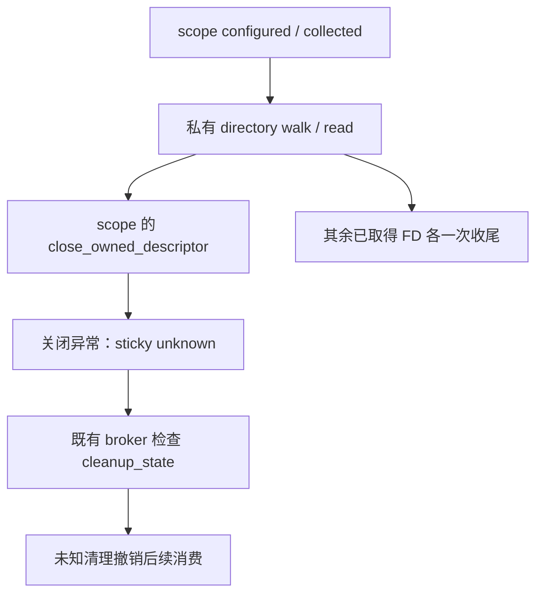

# Linux B2：scope 临时资源清理归属与首信号

状态：独立 DESIGN，尚未实施。当前 B1 四源码/测试仍冻结，原完整预检进行中；本文件不修改或扩大 B1 发布范围。

## 1. 需求与三问

scope 基线 SHA256 `776ab721fec0e18e73e21fbdbdfdc75cf123c68e2b7868aa25a0dee03c5c8b69`。真实问题：已经返回的 scope 在 configured 读取临时文件、walk 临时目录 FD 关闭未知后，仍可报告 cleanup_state=confirmed。独立研究者/root 分别运行真实 FD RAM 目标：每个路径各1有效 assertion FAIL、0error/skip、0.001s；临时 FD 仍活、其它 pins 已实际关闭、锁已释放的前置通过。__new__、membership/show 与目录入口局部注入不是真实 manager/native 证明，更不是正式 TDD。

另有 `_read_at` 的 finally 与构造 runtime probe/parent 收尾覆盖原 KI/SE：研究者/root 两方法、六有效身份断言 FAIL、0error/skip、均0.007s。真实 regular/目录/socket FD 前置成立，bus/trusted-tool 前提注入；卫生释放不计生产信用。

已有实现：scope `_close_owned_descriptor` 已 sticky 标记 unknown；`_select_cleanup_error` 已定义首异常/中断优先；`_trusted_tool` 已独立 drain 两个 FD 并保护首信号，不重复修复。调用链为 scope configured/collected→directory walk/read→临时 close，及构造 runtime probe/parent。三问均确认，局部复用而非新资源框架。

## 2. 职责与流程

临时 FD 的 owner 仍是取得它的组件；scope 传私有 close 机制只是明确此 scope 内资源的回收状态，不能转移给 helper/workspace/session 或借下一命令补偿。禁止重试未知 FD 数字；`_fds=[]`、pins 已关、函数异常或 construction_failed 都不是临时 FD 已回收确认。

## 3. 最小私有接口与配对

`_open_directory(path, *, uid, cgroup=False, close_descriptor=None)` 与 `_read_at(directory, name, limit=..., *, close_descriptor=None)` 拟增加默认 None 私有参数。None 时实际调用原 `os.close`，不改变旧 caller 的参数形状，不捕获 TypeError 重试探能力。非 None 为可信组件内部关闭函数，不接模型输入、不新增公开字段或 callback registry。

scope 的 runtime parent、configured 首次 pins/第二次身份重核、collected 的临时 directory walk，以及 configured 的全部五次 `_read_at`，明确配对传 `self._close_owned_descriptor`。不允许只给读取添加 hook 而漏掉 walk previous/current；所有 acquired 临时 FD 关闭异常都进入原 sticky unknown。最终已返回 directory FD 仍由现有 caller 持有并各一次关闭；返回之前 walk 的 previous 与失败时 current 分别各一次，不因 previous unknown 再试它。

`_read_at` 收尾复用 `_select_cleanup_error`：仍执行一次 close，保留原 KI/SE 对象；普通 body 加普通 cleanup 使用该项目已有首异常规则。成功 bytes/限额/读取顺序不变；此局部异常优先级修复不得扩大成公共诊断正文或授权。

构造 runtime probe 不再依赖 socket.__exit__ 的覆盖式 close；明确 probe/parent 独立收尾。probe 未取得时也必须关闭已取得 parent；已取得 probe 关闭失败后使用基类 `socket.socket.detach` 解除自动 owning，仍不授 OS 回收确认、不 retry 返回整数。detach 自身异常也参加既有选择规则，仍继续 parent；原首 KI/SE 不被普通清理覆盖。parent 使用 scope owning-close，关闭异常记录 unknown。成功构造的 uid/bus/peer/version 验证、flags、超时与 query 合同不变。

不改变 `_trusted_tool` 正确机制，不增 unit 操作、不改 cgroup/pids/deadline/native、不新增权限或依赖。opaque socketpair/selector、monitor parser/listener、原生 timeout 因果、S2/S3、Windows/macOS 与 R2/R3 整体验收仍独立。

## 4. 正式验收与范围

精确五路径：`src/icode/linux_task_scope.py`、新 `tests/test_linux_scope_temporary_cleanup.py`、本 DESIGN、配套 `docs/nbl/plans/2026-10-12-linux-scope-temporary-cleanup.md`、`docs/agent-landscape-live.md`。当前 B1 两工厂/测试、broker、母设计、vendor/native/CI 只读；main-only。需要改旧 fixture 时先追加独立设计证据，不顺手扩大。

先 DESIGN 独立 SPEC→不同 QUALITY，再完整 PLAN 双审；不同测试作者正式 RED，root 独立真实断言 RED后，不同源码作者最小修复。新测试须平台可 collection/正确 skip，不以缺属性、TypeError 或卫生错误计 RED。

至少覆盖：returned scope 两种临时 close unknown 及配置/收集/身份重核支路；真实 FD 仍活与 sticky unknown 分账；各 acquired FD close 恰一次、剩余 pins 收尾与锁释放；原 KI/SE、清理 KI/SE、probe/detach/parent 连续故障；after-close 数字复用不误关；默认 None helper、成功读取/walk/构造、旧异常与 flags 回归。整体验收需要 broker 实际收到 scope unknown并 faulted 后拒绝下一 borrow，不能只测字段或以构造 fail-closed 代替。

现有 B1 新8/原33、旧六模块163以及 `tests.test_linux_product_task_quota` 的已有真实 FD/首信号矩阵须复验，实际 skip 单列不授原生信用。fresh 实际 SOURCE SPEC→不同 QUALITY、root 唯一原完整 preflight（j1）、最终原文档 scanner 两轮、secret/submodule 单门及五路径 index/工作字节一致后才提交推送。B1 完整预检与发布未结束前只准只读/DOCS预备，不修改其冻结源码或测试。

## 5. 研究取舍与自检

独立研究实际 GET 窗口2026-10-12 05:45:04–05:46:31 UTC：CPython v3.11.15（PSF-2.0）的 [一次 close](https://github.com/python/cpython/blob/v3.11.15/Modules/posixmodule.c#L9418-L9433)、[socket context 收尾](https://github.com/python/cpython/blob/v3.11.15/Lib/socket.py#L236-L241)、[close/detach](https://github.com/python/cpython/blob/v3.11.15/Lib/socket.py#L495-L513)；Codex27065a91（Apache-2.0）的 [File owner 与引用消费](https://github.com/openai/codex/blob/27065a91ccbf5ba8532844be3777fcf83b77820d/codex-rs/linux-sandbox/src/bundled_bwrap.rs#L66-L100)及两 LICENSE 实际取得。未刷新 HEAD 或完整20名单。

采纳唯一 owner、一次关闭、未知不重试、动作/状态分账；首信号选择是 ICODE 已有合同，不归因于上游。收益为防误关、丢中断与误报确认；成本为两个局部 hook 及真实 FD/兼容矩阵。暂缓 opaque 内部与原生/安装实证；不适配 GC、detach、空 pins 或构造 gate授全部清理信用。无复制/新依赖/权限。

技术设计技能的职责/流程/私有接口结构适用，Java/Spring/HTTP/MQ/SQL模板不适用，不引入这些设施。

【架构级自检报告】（设计范围）

- 语法/编译：文档与真实符号已核，未修改/编译新源码。
- 依赖/调用链：读取、walk、构造、身份重核和收集均明确配对。
- 逻辑/边界：首信号、每FD一次、unknown sticky与剩余清理明确，实际修复待验证。
- 异常处理：保留项目既有选择规则，不重试未知数字；detach不确认。
- 关联模块：五路径，不改变broker/helper/workspace责任。
- 兼容安全：默认None旧参数形状与成功合同保持，无权限/依赖扩大。
- 可运行性：仅缺陷诊断与设计，正式TDD/完整预检/发布待执行，不报告100%。
