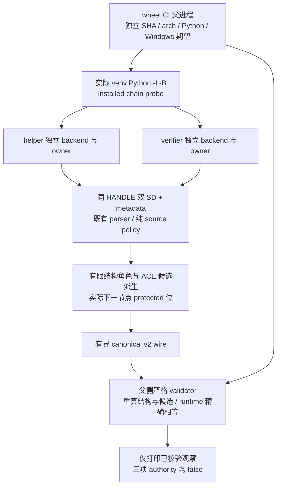
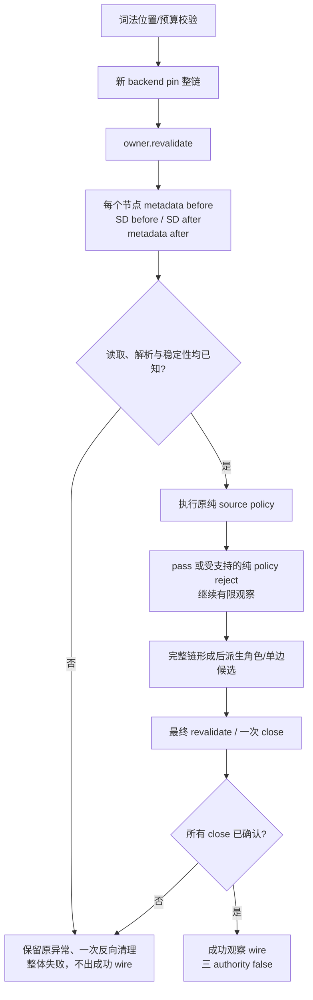

# Windows 已安装持有链结构角色有限诊断设计

日期：2026-10-12。状态：**DESIGN；未实施，未授予 Windows 原生、兼容或启动信用。**

当前源码基线：`main 574033a4df8311a569230bbd0522a0e1be717d8a`。本设计只规定后续诊断改动，不预授权生产准入变更。设计过程中只读核对了实际 probe、父调用、source validator、pin 所有权与 security parser；本次不运行测试、编译，不读取签名密钥，不写 Git。

## 1. 需求背景与验收边界

### 1.1 真实问题

当前 installed source consumer 的已确认拒绝位于 `helper/index=0`，理由是 `owner_untrusted`。按 `open_root → open_child` 的持有链顺序，index 0 是直接卷根。此结论只解释拒绝位置，不认证未知 owner，也不为短路后未检查节点增加政策信用。现场窗口与历史证据见[持续竞品对照](../../agent-landscape-live.md)末尾 Windows 角色段。

现有 `scripts/probe_windows_installed_chain.py` 已能够分别持有 helper/verifier 整链，在同一 HANDLE 上两次读取 SD，比较前后 metadata 与 descriptor，对成功解析后的纯 source policy 拒绝继续观察，并确认反向关闭。其 v1 wire 没有结构角色和 `SE_DACL_PROTECTED` 观察，`python/windows` 仅做范围检查；父 `scripts/run_windows_wheel_ci.py::_observe_installed_chain` 直接调用这个 validator，尚未像相邻 source observer 一样独立绑定父运行时版本。因此真实缺口是诊断表达与证据归属，不是已证明应放宽卷根 owner。

### 1.2 三问结论

| 问题 | 已确认事实 | 设计处理 |
| --- | --- | --- |
| 是否真实问题 | 卷根 source 拒绝需要区别目录操作与 leaf 操作；当前 wire 信息不足 | 增加有限观察，不调整政策 |
| 是否已有实现 | held chain、双 SD、metadata、parser control、纯 policy 分类、ledger、raw capture 均已存在 | 复用以上实现；不新增 native API |
| 是否影响调用链 | chain probe → 严格 validator → wheel CI 父 observer → 已安装 Windows 四格 | 新 schema 与父期望参数同步；保留 fail-closed |

### 1.3 目标与非目标

目标是准确回答“拒绝节点在链上承担哪些结构角色、实际 ACE 有哪些直接操作候选、实际下一节点 DACL 是否有继承保护位”。成功仍必须有 `protected_observed=false`、`compatibility_accepted=false`、`launch_authorized=false`。`source_policy_all_passed` 仅重述原有纯 source policy，不成为准入结果。

本片不改变 `source/protected` 信任域、allowed owner、security/pin/consumer 准入、readiness、系统 ACL、服务、MSIX、token 权限、UAC、依赖或 native API。不会模拟完整 AccessCheck，也不解释 pre-main DLL、publisher 或全加载窗口安全。原 Reviewer/WFP unknown、UAC 和 pre-main DLL 边界继续未完成。若诊断必须修改生产 security、pin 或 consumer 合同，停止本片并回到新设计。

## 2. 整体架构与实际调用链

源码锚点为 `scripts/probe_windows_installed_chain.py::_installed_resources/_observe_resource/probe/validate_wire`，`scripts/run_windows_wheel_ci.py::_observe_installed_chain`（当前行 175）及 main 中实际 installed 调用（当前行 420）；runtime 绑定复用相邻 `_observe_installed_source` 和 `scripts/probe_windows_installed_source.py::validate_wire` 的必需 keyword 参数模式。持有与回收复用 `src/icode/windows_startup_pin.py::PinnedStartupFile`，读取复用 `windows_startup_native.py::WindowsStartupPinBackend` 与 `windows_startup_security_native.py`，解析复用 `windows_startup_security.py::parse_startup_security` 的 `control/entries`。

`-I` 排除 checkout/PYTHONPATH 导入，允许正常 installed site packages；它不是 OS sandbox。包位置仍按词法 `purelib/icode/__init__.py` 与固定 native 名称校验，不 `resolve`，不以 workspace 镜像代替安装资源。hash 来自实际 held image bytes，但观察 wire 本身不是独立 OS 证明。

helper/verifier 必须各有新 backend、独立 owner、独立 HANDLE 登记和 close ledger；只共享全局 ACE 预算。同一卷根或同一数值 HANDLE 出现在不同 backend，不能据此合并身份、观察、关闭计数或释放动作。

## 3. 技术设计

### 3.1 结构角色与信任角色正交

对已核定长度 `n` 的实际持有链，要求 `2 ≤ n ≤ 32`；按既有 root-to-leaf 顺序派生角色，不能接受 wire 自报位置。

| 结构角色 | 位置/对象要求 |
| --- | --- |
| `route_ancestor` | 每个目录：index `0..n-2`，含卷根和镜像父目录 |
| `volume_root` | index `0`，必须是目录 |
| `image_parent` | index `n-2`，必须是目录 |
| `image_leaf` | index `n-1`，唯一非目录 |

一个节点可有多个角色，按固定顺序 `route_ancestor, volume_root, image_parent, image_leaf` 输出满足条件的并集，无重复。`n=2` 时 root 同时为前三种，leaf 仅为 `image_leaf`。保留既有 `kind=root/ancestor/file` 和 `directory`，validator 根据 index/n 重算并同时检查，不借 `kind` 取代完整角色集。

资源原字段 `role=source` 是既有信任角色，保持原名与语义；新增字段命名为 `structural_roles`，禁止用结构角色取代 source/protected。没有新增 protected 资源观察。

### 3.2 同对象观察与失败流程

继续遍历仅适用于已成功读取并解析 SD 后，原纯 policy 调用返回已知 `owner_untrusted/mutation_untrusted/empty_dacl`；不适用于 IO、descriptor、metadata、parser、身份捕获/回收或 HANDLE close 未知。未知异常不得改成 policy reject、空数组、默认 false、warning 或部分成功。`BaseException` 与原有复合清理语义保持；不重试可能已经释放的数值 HANDLE。

两次 SD 相等只证明这两次观察一致，不冻结 ACL 或后续权限。派生下一节点信息必须等待它的实际读取完成，不能从父 ACE 或路径推测 child control。保持每节点 metadata 前后核对、全链开始/结束 revalidate、完整 ledger 确认后才返回资源结果；后一个资源失败使整个 probe 失败，前一个资源观察不单独发布。

### 3.3 直接操作候选

保留旧 entry 的 `allowed/flags/mutation/trustee`。旧 `mutation` 与 `_receipt_policy` 使用的掩码/IO处理完全不改；增加 `direct_operation_candidates` 作为诊断。只有实际 `allowed=true` 且 `(flags & 0x08)==0` 的 ACE 才生成直接候选。deny 和 inherit-only ACE 的该数组为空，但仍保留完整有限 flags/mutation 供原政策与继承观察消费。

候选按下表顺序排列，固定 enum，无重复；由 entry 的已保留 mutation 位与实际 `directory` 派生，不做 generic access 展开。

| 位 | 目录候选 | leaf 候选 |
| --- | --- | --- |
| `0x2` | `add_file` | `write_data` |
| `0x4` | `add_subdirectory` | `append_data` |
| `0x40` | `delete_child` | 不生成；leaf mutation 不含此位 |
| `0x10` | `write_ea` | `write_ea` |
| `0x100` | `write_attributes` | `write_attributes` |
| `0x10000` | `delete_object` | `delete_object` |
| `0x40000` | `write_dacl` | `write_dacl` |
| `0x80000` | `write_owner` | `write_owner` |
| `0x40000000` | `generic_write` | `generic_write` |
| `0x10000000` | `generic_all` | `generic_all` |

这些候选表示“观察到对应 allowed ACE 位”，不是某主体实际可执行该操作。没有检查 token groups、subject、privilege、ACE 顺序、deny 优先级、generic mapping 或对象管理器行为；不能据此授予或排除 effective access。deny 不抵消诊断风险或原有 mutation 拒绝。

owner 可能具有隐含 `WRITE_DAC`，不能因没有 direct ACE 候选就宣告安全；owner 固定分类只是类别，不能证明 `other` 的实际主体。`creator_owner` 的继承替换与 `owner_rights` 对所有者权利的控制均不能由有限类别模拟。原 source policy 对 owner_rights 的既有处理保持，诊断不新增 owner/subject 信任推断。

### 3.4 实际 DACL control 与单父子边继承观察

节点新增 `dacl_protected`，只从已支持且两次相等的 actual SD `control & 0x1000` 提取 exact bool。现有 parser 已接收该 control，无需新增 native 查询或生产 parser 放宽。缺失/不支持 control、任一读取失败均整体拒绝，不能 `get(..., False)`。

flags 继续保留 `0..0x1f` 的有限 mask：OI=`0x01`，CI=`0x02`，NP=`0x04`，IO=`0x08`，INHERITED=`0x10`。NP 只限制下一代继续传播，IO 不排除向下一节点的旗标候选；实际生效状态、转换后的 ACE 和多代复制不在本片计算。

每个目录节点新增唯一 `inheritance_to_next`，目标恰为实际 index+1。对象包含 `next_index`、`target_kind=directory/file`、`child_dacl_protected`、`flag_candidate_indices`、`state`。candidate indices 是本父节点 entries 中按原始顺序满足“下一节点为目录则有 CI，为 file 则有 OI”的全部 ACE index；包含 allowed/deny、IO/NP，不能把直接候选筛选错误地套用于继承旗标。flags 保留在对应 entry 中，无额外 SID 或原始 ACE。

`child_dacl_protected` 必须等于实际下一节点的 `dacl_protected`。`state` 为固定 enum：空 candidate 数组时 `no_flag_candidates`；有 candidate 且 child protected 时 `flag_candidates_child_protected`；否则 `flag_candidates_child_unprotected`。protected 不是“所有风险被屏障消除”，unprotected 不是“ACE 已继承”，candidate 不是实际子 DACL 中对应 ACE 存在的证明。该对象仅结合父旗标与实际 child control 记录单边观察；不追踪同一 SID、ACE 身份或跨资源继承链。leaf 的 `inheritance_to_next` 必须为 JSON `null`，这是结构已知的无下一节点，不代表 unknown。

`SE_DACL_PROTECTED` 阻断继承 ACE 修改本对象 DACL，不抵消父目录 `delete_child`、父目录创建同名对象、本对象显式 ACE 修改或 owner 权利；特别不能由 protected leaf 推论安全目录路线。OI-only/CI-only/IO/NP/INHERITED 的组合必须独立负控，未实现的继承算法不写成已经验证。

## 4. 内部 API 与有限 wire 契约

本片没有 HTTP、MQ、数据库或 Java Entity。技术设计 skill 的 API/模型模板落实为已有 Python 内部函数与 JSON 观察合同；Spring/MySQL 规则不引入到本仓库。

### 4.1 版本与调用参数

新观察使用 `schema_version=2`，保留 `scope=installed_source_chain_observation`。v2 validator 拒绝 v1 或未知版本，不填充 v1 缺失字段；历史 v1 仅由其当时版本 validator 核历史合同，不重标成 v2 或补授角色/runtime/native 信用。无需新建兼容分支或第二个 probe。

后续内部签名为 `validate_wire(wire, source_sha, arch, *, expected_python, expected_windows)`，两个 keyword 参数无默认值。父 `_observe_installed_chain` 在启动 child 前，从 `sys.version_info` 与 `sys.getwindowsversion()` 捕获期望；当前 venv 由同一父解释器创建，因此允许使用相邻 source observer 的来源。若以后更换 Python 来源，应先另定可信绑定，不能从 child wire 自取期望。

父 validator 同时验证 expected 值自身 exact 类型/长度/范围和 wire 值，再要求 Python `[major, minor]`、Windows `[major, minor, build]` 精确相等。支持范围内的错误版本仍拒绝。SHA/arch 保持父侧已知绑定，不接受 wire 值作 expected。probe 自消费输出的本地校验可用它实际采集的版本，但该步骤不获得父独立 runtime 验证信用。

### 4.2 v2 对象的精确键集合

| 对象 | 必需且仅允许的键 |
| --- | --- |
| top | `schema_version, scope, source_sha, architecture, python, windows, observation_complete, source_policy_all_passed, protected_observed, compatibility_accepted, launch_authorized, resources` |
| resource | `resource, role, image_sha256, chain, owned_handles, confirmed_closes, unconfirmed_closes` |
| node | 原有 `index, kind, directory, metadata_observed_equal, descriptor_observed_equal, parser_result, policy_result, owner, entries` 加 `structural_roles, dacl_protected, inheritance_to_next` |
| entry | 原有 `allowed, flags, mutation, trustee` 加 `direct_operation_candidates` |
| inheritance edge | `next_index, target_kind, child_dacl_protected, flag_candidate_indices, state` |

所有新 arrays 必须为 exact list、固定顺序、无重复，元素须 exact int/string；bool 不得作为 int。索引以实际 entries/chain 长度为上限。validator 重算结构角色、直接候选、edge target/indices/state，以及原有 policy/all_passed；键缺失/多余、duplicate JSON key、错误类型、伪造摘要全部拒绝。`parser_result` 成功仍只允许 `supported`，没有 `unknown` 成功值；`dacl_protected` exact bool 必需，不能以默认 false 吞未知。有限 wire validator 可核内部一致性，不能从脱敏 wire 独立证明 OS SD control 的真实性。

继承派生必须两阶段执行：先完整校验全部 nodes/entries，再引用下一节点；避免用尚未校验的 child bool 建立可信摘要。原 owner enum `admin/system/host/other`、trustee enum 加 `everyone/authenticated_users/builtin_users/creator_owner/owner_rights` 保持，不扩张。

### 4.3 预算、运输与日志

继续使用 `32 nodes/resource`、两个固定有序资源 `helper,verifier`、全局 `512 observed ACE`（两次快照各计一次，即输出 ACE 总数至多 256）、`256 KiB wire`（包含唯一尾部 LF/CRLF）和现有父 capture timeout/output limit。不因为字段新增放大预算。每 ACE 直接候选最多 10 个；每 edge indices 不超过对应 entries 数；由以上上界约束总输出与计算。

父只允许 capture exact `(code, stdout, stderr)` tuple、退出 0、stdout exact bytes、stderr 空 bytes；strict canonical JSON、禁止 duplicate keys、严格编码、唯一尾行、未知字段/枚举拒绝。限制、超时、未知 pipe cleanup、退出失败与无效 wire 均固定失败，不重试、不 replace-decode、不打印未校验 stdout/stderr/异常 cause。

不输出 path、盘符、SID、账户名、raw descriptor/body、HANDLE 值、file ID 或异常私有文本。保留既有 SHA、有限 enum、位 mask、索引、ledger 与版本。成功 top 的 `observation_complete=true` 只有全部读取、完整派生与确认关闭后可输出；三 authority exact false。父成功摘要应同时明确 `protected_observed=false`，避免新 protected 位观察被误读为 protected 信任域验收。

## 5. 模型与最小改动范围

所有模型为 probe 内有限观察 dict/list，短生命周期，无存储层、迁移、额外权限或依赖。原始 SD、路径与 SID 只在现有内部处理阶段存在，不进入 wire；关闭所有 owner 后只保留脱敏观察。

后续必要源码范围限于 `scripts/probe_windows_installed_chain.py`（派生/schema/validator/CLI自校验）与 `scripts/run_windows_wheel_ci.py`（父 runtime 期望与明确成功摘要）。复用 `tests/test_windows_installed_chain.py` 和 `tests/test_windows_bootstrap_binding.py` 增加实际行为负控；如新必需测试方法数改变，最小同步 `tests/test_windows_startup_pin_ci.py` 与现有 CI 清单/命中守护，不能静默少执行。实施计划应先列出真实引用与计数，再确定这一条件性关联范围。

不修改 source observer、production security/native/pin、consumer、readiness 或启动 gate；现有接口引用必须逐一检查，包括 receipt/CLI self-validator、父 observer、test receipt、capture mocks、Windows job 必需方法命中检查。测试夹具只能在自有临时对象上设置正负控，不改真实系统根 ACL。实现出现更大关联改动时返回设计，不能将本片变成根兼容修复。

## 6. 验收与分阶段交付

本节是后续验收要求，不是本次已执行结果。

| 阶段 | 必须取得的证据 | 不可替代项 |
| --- | --- | --- |
| 设计冻结 | fresh 独立 SPEC，随后不同 QUALITY；重要缺口先修订设计 | 设计评审不授权源码实施或 native ready |
| 软件实现 | 负控先失败再通过；目标 suite 实际命中；fresh SPEC → 不同 QUALITY；root 完整验收 | Linux mocks 不等于 Windows native |
| Windows 安装 | 同一最终 SHA 的 x64/ARM64 × Python3.11/3.12 四格，实际签名安装 helper/verifier 与 v2 wire；root 与独立观察者以独立 runtime 期望严格核验 | workflow success、签名、旧 v1、workspace 夹具不能替代 installed 观察 |

必须覆盖的负控包括：两节点根角色并集；每个中间目录均为 route_ancestor；伪造/缺失/重复角色拒绝；目录 0x2/0x4/0x40 与 leaf 语义分离；allowed non-IO 直接候选、deny/IO 无直接候选而原政策不变；OI-only/CI-only/NP/IO/INHERITED 组合；真实下一节点 protected on/off、父 protected 不能替 child；伪造 child bool/indices/state 拒绝；有界预算与 n 越界；双 SD 漂移、metadata 漂移、unsupported parser、IO/close unknown 整体失败；policy 拒绝继续观察仍无授权；跨 backend HANDLE 数字相同保持独立 ledger；错误 expected runtime、supported-range 错版本、bool/int 混用、v1/未知版本、重复/额外/缺失字段、私有输出负控与 capture 超时/限制/未知清理。

自有 descriptor byte 夹具验证 parser/派生；自有 Windows native 目录/file 夹具验证实际 held SD 的 protected 位及 flags 观察、同 HANDLE 与回收。两者都不能替代 installed 四格真实读取。四格必须报告必需测试实际 hit、无新增隐藏 skip、每资源 owned/confirmed/unconfirmed、全局 ACE budget、v2 canonical wire 与目标 SHA；若当前真实卷根仍 owner_untrusted，应如实保留，该拒绝并不阻止完成非授权诊断。

root 完整验收与项目既有完整 gate/ICODE-SKILL 合同按实施阶段执行并报告实际结果，不能只凭命令 exit 0 或模拟通过。最终四份 wire 应由 root 和另一独立观察者各校 SHA、arch、父 runtime、完整 schema、ledger 与三 authority；需要持续保留旧 Reviewer/WFP unknown、UAC、pre-main DLL 未完成边界。

## 7. 研究取舍、风险与设计自检

研究复用[持续竞品对照](../../agent-landscape-live.md)本轮末尾角色记录，不重查二十项目 HEAD。MicrosoftDocs/win32 固定提交 `ca8274decead49403d70ceeed4af8d4ca74eaf11` 的[文件/目录权限常量](https://github.com/MicrosoftDocs/win32/blob/ca8274decead49403d70ceeed4af8d4ca74eaf11/desktop-src/FileIO/file-access-rights-constants.md)与[descriptor control](https://github.com/MicrosoftDocs/win32/blob/ca8274decead49403d70ceeed4af8d4ca74eaf11/desktop-src/SecAuthZ/security-descriptor-control.md)，文档日期均 2018-05-31；root 本轮实际读取固定提交的 [LICENSE](https://github.com/MicrosoftDocs/win32/blob/ca8274decead49403d70ceeed4af8d4ca74eaf11/LICENSE)，确认 CC-BY-4.0。本设计借鉴机制，不复制原文/实现，不新增运行时许可、依赖或安全权限。固定 Codex `8c0f7011674145da7e10627769fb221c74fbf7a0` 的 [no_reparse_dir.rs](https://github.com/openai/codex/blob/8c0f7011674145da7e10627769fb221c74fbf7a0/codex-rs/windows-sandbox-rs/src/no_reparse_dir.rs)（Apache-2.0）只复用既有研究的职责分离依据。

**采纳：**复用实际 held chain 与有限 ACE/control 派生；结构角色并集；父独立 runtime 精确绑定；旧 policy 结果保留。收益是解释卷根与父目录风险并防止错格回执，成本是 v2 同步、负控、有限预算与 Windows 安装四格验证。**暂缓：**系统根 owner 例外、生产继承屏障合同、effective-access 算法与 UAC。**不适配：**新增 allowed owner、系统 ACL 改写、未知降级 pass、diagnostic bool 替代 AccessCheck、私有夹具替未知系统 owner 认证或提前承诺兼容率。

主要风险是结构/信任角色混淆、IO/目录位误解释、child protected 被当全部安全、wire 自报告 runtime、跨资源 ledger 合并和旧 wire 补授信用。对应约束和负控已逐项明确；尚未通过任何新软件或 native 执行验证。

【架构级自检报告】

- ✅ 语法/编译：文档 Markdown、表格、Mermaid 与合同字段人工核对；未改代码，未运行编译。
- ✅ 依赖/调用链：已读实际 chain probe、父 observer/source validator、pin/security 路径，列出 CLI/test/CI 关联点；后续实现仍须验真实调用。
- ✅ 逻辑/边界：角色并集、n=2、flags/目录位、两阶段 child 引用、预算与旧版本边界在设计中闭合；未声称代码已通过。
- ✅ 异常处理：未知读取/解析/漂移/close/capture 整体拒绝，纯 policy 分类单独继续；禁止未知默认 false。
- ✅ 关联模块：设计仅新增本文；后续最小诊断与测试范围明确，生产准入/readiness 不变。
- ✅ 兼容安全：v1 不自动升级，v2 拒绝未知字段/版本；三 authority 恒 false，保留未完成原生安全边界。
- ✅ 可运行性：设计适配现有接口与已支持 control；本次为 DESIGN，不提供“100% 已可运行”或 native ready 声明，实施和实机验收均待后续阶段。
