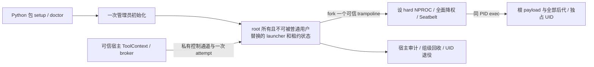

# macOS 任务专用身份与进程硬配额设计

- 日期：2026-10-13；状态：DESIGN 候选，未实施、未安装、未取得原生验收。
- 基线：ICODE `e54ec8de3d0fd2dd76d1aac7d765ab1d742e2f7d`，vendor `21566a589cbe98bd35372a04bbb6ca1c51d8eed2`；权威工作区 `/home/orbbec/projects/icode`。
- 用户已同意设计验证“一次管理员初始化＋任务专用隔离身份＋受控启动器”，Python 包提供入口；未验收不启用，不放宽单任务配额或至少 90% 合同。本次只写本文；源码、安装、系统授权和 CI 另经阶段计划及审查。
- 结构化思考：root 本次实际 sequential-thinking 三步记录 `352dff`。作者工具目录未提供该 MCP，没有冒称作者调用；以下记录作者的需求、方案、风险推演。

## 1. 真实问题与现有调用链

需求分解：每次 `run_command` 根 payload 计 1，全部后代计入，同步并发命令各有独立额度；broker、launcher、observer 位于计数边界外。沿 [已确认进程合同](2026-10-08-r2-process-limit-contract.md) 与 [R2 §6.2/§14](2026-09-23-r2-cross-platform-isolation-design.md)，macOS 同组清理例外保留，资源与违规回执仍须实际通过，不以 UID 限额直接冒充任务限额。

现有实现：`src/icode/isolation.py:MacSeatbeltSandbox` 生成 Seatbelt profile；`_MAC_PROCESS_RULES` 允许 exec/fork。`experimental_wrap_policy` 仅实验，无正式 `wrap_policy`，`policy_contract_ready=False`，能力说明列进程上限为未执行。`tools/builtin.py:run_command → _controlled_dispatch → ctx.wrap_command → execution_broker.execute_policy_command` 是通用策略调用链，Linux 单任务资源路径另有专门 dispatch。macOS 目前未消费 `SandboxPolicy.process_limit` 为实际原生硬限。新增身份服务必须接此真实入口，不能只给孤立探针“通过”。

方案分析：若一个非 root real UID 的进程集合恰好等于一个任务集合，每个成员继承不高于 N 的 hard NPROC，XNU 的 UID 总进程准入可成为这个任务的进程上限。此等价取决于专用身份、不可变凭据、继承和租约证明，不能由设置 rlimit 单独得出。

风险评估：身份切换本身不执行 NPROC 的 fork 准入检查；共享 UID、persona、提权 exec、额外同 UID helper、旧后代和 UID 重用都会破坏等价。先有限内核验证，任何反例未封闭就拒绝生产接线。本文不设计聚合内存硬限；不能由进程限额成功外推该能力。

## 2. 主源证据与路线取舍

观察日 2026-10-13，主源使用 Apple 固定发布标识 `xnu-12377.1.9`；实际机器内核版本必须另录，公开标识不证明其与所有受支持 macOS 二进制一致。只借机制，不复制源码。下列 XNU 文件含 APSL-2.0 与文件内 Berkeley 等声明；许可范围按具体文件核对，不把整库笼统当单一许可证。

| 主源 | 本次实际观察 | 设计约束 |
| --- | --- | --- |
| [kern_fork.c:fork1 / proc_limitfork](https://github.com/apple-oss-distributions/xnu/blob/xnu-12377.1.9/bsd/kern/kern_fork.c) | `fork1` 为新进程共同路径；以 real UID 增计，检查父进程 soft NPROC，非零 UID 超限 EAGAIN；失败撤计；派生继承 plimit | payload 全部非 root，cur=max=N；fork-only 也必须受限；线程口径须分别原生核 |
| [kern_prot.c:setuid / setreuid](https://github.com/apple-oss-distributions/xnu/blob/xnu-12377.1.9/bsd/kern/kern_prot.c) | 特权 setuid 改 real/effective/saved UID；real UID 改变迁移进程计数，persona 条件例外 | launcher 只能向全空的已锁定 UID 迁移一个根，禁止通过重复 root→UID 迁移增发 payload |
| [kern_resource.c:dosetrlimit](https://github.com/apple-oss-distributions/xnu/blob/xnu-12377.1.9/bsd/kern/kern_resource.c) | soft≤hard；提高 hard 要 superuser；NPROC 还受宿主上限钳制 | 设置后逐字段读回，不接受静默钳制或以降配额算成功 |
| [Apple ES 事件枚举](https://developer.apple.com/documentation/endpointsecurity/es_event_type_t)（当日 JSON 枚举实际读取） | 有 NOTIFY_FORK，未见 AUTH_FORK | ES 不能单独同步阻止 fork-only 越限，AUTH_EXEC 不能代替 |

| 路线 | 决策 | 收益、成本及验收 |
| --- | --- | --- |
| 独占 UID＋可信 launcher＋hard NPROC | 采纳为条件候选 | 最接近现有 native Seatbelt 工具链；新增一次管理员初始化和长期可信组件，必须证明任务集合等价与身份不可逃逸；M0 任一失败即暂缓 |
| Endpoint Security 扩展 | 不适配本次硬上限 | 可观测事件，但缺少此证据范围内的 fork 准入钩子；签名/entitlement/扩展成本不能换成硬限信用 |
| 每任务 VM | 暂缓替代路线 | 可提供独立 guest 计数域；Linux guest cgroup 可限制，但原生 macOS 工具链、文件语义与至少 90% 能力须重验；macOS guest 仍需自己的合格计数机制，不能只限制 VM 数或 vCPU 数 |

旧研究与 [handoff](../../development-handoff.md) 中“未授权”是此前时点。本次授权只推进设计验证，不回溯改写旧结论，也不使现行 ready 成真。

## 3. 最小架构与信任边界

root 服务只承担身份分配、启动受控 trampoline、确认状态和租约终结；不运行 Python 包代码、工作区脚本、shell、构建插件或 payload。root 子进程降权前只执行安装固定的最小 native trampoline，不解析工作区配置、动态加载用户库或进入工作区。控制通道、审计及服务父进程始终不使用任务 UID。降权后的 trampoline 原地 exec 为根 payload，禁止多留一个计数 helper 后“扣 1”。

模型工具只调用已有 `run_command`。root 服务入口不注册为模型/MCP 工具；任务不能访问服务 socket、连接能力或 token。宿主与服务绑定 OS peer 身份、批准的宿主实例、安装版本、task/attempt、policy hash、workspace 身份与唯一请求 nonce；仅校验 socket 的普通用户 UID 不足以隔离该用户其它进程。M1 必须选定并实际验证可用的 native peer/audit 身份与实例通道传递方式；未证明则停在候选，不以隐藏路径充当认证。

普通宿主用户按原威胁模型属于可信控制面；模型或工作区不能任意编程该控制面。若要求抵御恶意同宿主用户替换全部宿主 Python 代码，需增加受保护宿主 launcher/实例身份，这超出 pip 文件哈希自证的能力，M1 必须明确支持边界，不能把任务 UID 不同当宿主认证。

## 4. UID 租约：先禁用重用，后单独证明回收

一次管理员初始化建立有界、碰撞检查过的非 root 本地身份池和专用组：禁交互登录、无可用密码、无管理员/宿主用户附加组，不接入其它服务或 cron/launchd 任务。具体 UID 范围由宿主目录服务检查决定，不硬编码可撞现有账户的编号。安装清单记录每个身份与专属工作区；持续检查外部账户/服务改动。攻击者拥有 root 的场景不在此合同内。

最小状态机：`unused → reserved → configured → started → retiring → retired`；任意未知、残留或重启恢复不完整进入 `quarantined`。状态由 root 单写、持久化、带 epoch/attempt；reserve 和启动计数原子化，同一 UID 不能双租、同一 attempt 不能重复迁移根。`reserved` 前枚举该 UID 全部进程（含不能确定归属、僵尸等占数风险）；非零或枚举失败就 quarantine。枚举为发现污染与拒绝机制，配额执行仍是内核 fork 准入，不能靠枚举后 kill。

本最小片采用**使用过的 UID 不自动再发放**，即使当前无进程也进入 retired。这样无需把两次 ps 空采样误认永久无后代。池耗尽返回 scope unavailable、没有 payload；有界身份池的有限任务容量必须在 setup/doctor 展示。后续自动回收是独立设计：证明所有潜在再派生源已消失、旧进程/打开文件/Mach/共享内存/套接字等跨任务能力失效，并清理旧可访问对象之后才能重用；本片不批准该优化。

旧任务脱组后代可继续占自己的退役 UID，仍有旧 NPROC、Seatbelt 与旧独立工作区；不赋予新 workspace/toolchain 私有对象权限、不复用路径、不扩大其 ACL。新任务用另一个 UID 和新目录，旧进程不计入新额度。组级清理成功只报告 group scope；残留/unknown 记录 quarantine，不声称整树零残留。不能撤 ACL 之后就认为已有打开 FD 已撤销访问。

## 5. 受控启动事务

1. 宿主先验证 policy、已有 workspace session/cwd、工具链和 timeout/output budget，服务校验安装来源与双方实例绑定；不存在 qualified scope 时 fail-closed。
2. root 对 unused UID 独占 reserve，验证无同 UID 进程、无 persona/其它启动源；建立新的管理目录与最小 ACL，冻结本 attempt 请求，持久化。
3. root 只 fork 一个固定 trampoline。此 fork 在 root 计数域；child 仍不接触 payload，清信号/环境/FD，只保留经过验证的状态管道和 I/O。服务拒绝第二次 root→同 UID 迁移。
4. trampoline 将 soft/hard NPROC 都设 N 并完整读回；移除全部继承的 host/root supplementary groups，仅保留任务专用 GID（XNU 的组列表非空语义），设置专用 real/effective/saved GID，再用特权 setuid 一次设置专用 real/effective/saved UID。逐字段读回组列表必须恰好只有该专用 GID，无额外组；每步返回值与最终凭据验证，saved root、persona 或额外组残留均拒绝。
5. 迁移后的 trampoline 是未来 payload 根，占 UID 的第一个位置。XNU setuid 的计数迁移不是限额检查，因此必须依赖步骤 2/3 的专用域和单根准入；不得用 posix_spawn SETUID 直接运行不可信目标来绕过此顺序。
6. 降权后固定系统 Seatbelt 启动路径原地 exec，应用可信编译 profile，再同 PID exec 根 payload。准确 exec 链/继承与无额外进程必须由 M0 证明；若系统工具产生额外 helper，则该链不可接受，另设计固定 native sandbox 应用方式，不增 N。
7. 只有凭据、quota、Seatbelt 和通道关闭确认满足阶段协议才释放 payload 执行。任何失败：终结可信 child、保留审计并退役/quarantine UID；确定没有 payload 执行才返回 `payload_started=false`。exec 结果不明或连接中断返回 unknown，禁止谎报 false 或重试造成第二根。

N 为有效正整数，cap=1/2 必须精确生效；不允许 N+helper、系统限制静默压低 N、root payload、设置失败裸执行。进程上限限制同时存在的进程，允许已退出/reaped 子进程之后合法再派生；僵尸及 exec 的实际计数变化由探针记录，不能用采样最大值代替拒绝 oracle。

身份固定必须同时覆盖 setuid/seteuid/setreuid、saved UID/GID、setgroups、persona/线程身份、setuid/setgid executable、posix_spawn 特权属性、launchd/Mach/Launch Services 外部代启动和 task-port 注入。沿 deny-default Seatbelt 做最小规则；具体 operation 名和对 set-id exec 的效果未由公开规则证明，M0 使用真实逃逸向量核验。不能只写猜测的 deny operation 或检查可执行文件 mode 一次就宣称所有后代被封闭。

## 6. 文件、工具链与网络兼容

只对新任务的受管镜像授最小读/写/遍历权限，原仓库、`.git`、ICODE-SKILL、账本、证据与其它任务目录仍受保护。root 不递归 chown 用户工程、不扩大整个 host home ACL；权限准备/撤销失败拒绝启动。隔离工作区与受保护 Git 元数据按现有 broker 分工投影，直接 Git 操作保持原 guard，不以添加 safe.directory 全局例外消除身份错误。

HOME/TMPDIR 为该任务专属空目录；环境为宿主选定白名单，排除宿主凭据、SSH agent、模型 KEY、代理秘密、DYLD 与 Python 注入变量及控制 FD。现有 Python venv 常位于宿主 home；不能直接允许整段 `sys.prefix` 读取就带入 credentials：必须预先确认独立可信可读工具链的完整路径、库、SDK、缓存需求，并以真实 Python/Git/编译器验证必要范围。不可访问的用户 venv明确拒绝或使用已安装可读工具链，不能声称原用户环境完全兼容。

网络 DENY 从实际 policy 继承，身份改变不提供网络隔离。临时授权代理沿现有独立 lease/服务链另验；给任务 UID 私有 endpoint 最小 connect 权限，不让其接触 root control socket 或 host proxy credential。现有 macOS UDS 实验只提供目录范围规则，不能假定可直接复用为安全 root 控制通道。task A 对 B 的 Unix socket/Mach/信号/内存/文件负例同时验收。

## 7. 安装、升级、卸载与内部接口

Python 包只提供用户入口及平台/架构发现；安装候选先验证 fixed manifest、完整 helper hash、发布者签名/来源、架构和版本，再由用户已同意的一次管理员初始化流程复制到 root 管理位置。root launcher、launchd 配置、状态目录及所有祖先不能被任务或普通用户修改/替换，检查 symlink、可写父目录、加载库、环境和升级来源；下载/pip包文件存在不等于已可信安装。不得运行从工作区或用户可写路径导入的 root Python 安装逻辑。

建议内部 native 协议（尚未实现）：`reserve / configure / launch / status / retire`，均固定版本、有界长度、字段白名单、一次 attempt；外部 shell/path-to-sudo/get-root 方法不存在。请求携带 task/attempt/epoch/policy digest、N、已绑定 workspace/toolchain、argv digest 和预算；实际 argv仅短期私有 IPC，不落日志。返回实际 PID/start identity、UID/GID、读回限值、phase、payload start 三态、错误类别和退役状态；具体 wire/OS身份 API 在 M1 PLAN 冻结。

升级先停新任务，旧租约终结或 quarantine，安装新受保护对象并核来源；版本错配、回执过期或中断恢复拒绝新启动。卸载先停入口、处理本服务自有租约，保留有残留的 UID/目录隔离记录；不能直接删除账户然后把编号交给普通用户或新任务。用户数据与旧任务工作区保留/清理按明确选择处理，管理员卸载不包含危险跨目录递归删除。

审计由宿主/root 写受保护状态：实际候选 SHA、installer/helper哈希、OS build/kernel/arch、task与attempt摘要、身份epoch、限值读回、准入/exec/errno、终态、组级清理与UID退役。不得记录 KEY、完整 argv、环境和未经脱敏的工作区内容。安装/签名/身份存在与 quota实测各为独立字段，doctor 不由声明生成 ready。

## 8. 阶段依赖与严格 oracle

所有 native 验证绑定实际候选 SHA、完整原日志、OS build/kernel、架构、helper/manifest hash、job 与退出状态。失败、SKIP、缺样本、timeout 和“看起来没有 marker”都不是成功。M0 首先对 x86_64 与 arm64 当前支持 OS各运行有限、有界探针，不本机全量构建；只在隔离可销毁 macOS 环境做管理员实验。WSL不能授 macOS信用。

| 阶段 | 内容与依赖 | 必须同时满足的 oracle |
| --- | --- | --- |
| M0 内核有限验证 | 固定 native 探针；不接产品、不装长期服务 | cap1 根可运行、fork-only/exec/spawn 后代在创建时 EAGAIN无执行；cap2 根＋一个阻塞后代成功，第三个 EAGAIN，reap后可再fork；多线程根不消耗额外进程quota（实际测并记录口径）；并发多父fork在N准入原子界内；soft提高至N合法，hard提高失败；UID迁移根计1；全部身份/特权exec/persona/代启动逃逸反例失败。失败对照关闭NPROC可成功且探针自身资源不耗尽 |
| M1 可信安装与租约 | 依赖M0全通过；native launcher及Python入口有限实现 | 干净安装/重复setup/权限拒绝/坏hash/旧版本/替换祖先或库均准确拒绝；root child在执行任何payload前全面降权；双租/重放/服务重启/host死亡/IPC中断/污染UID拒绝或quarantine；任务无法连接控制面；cap1无额外helper；池耗尽无payload；无自动重用，旧后代不能取得新task路径或额度 |
| M2 现有policy/task接线 | 依赖M1；真实run_command/ToolContext/Agent/broker入口 | exact policy.process_limit→本attempt原生cur/hard；多个同任务命令各独立lease；文件/网络/继承/Reviewer保护正负控；正常/timeout/cancel/output超量/异常与detach保留真实scope；配置失败无marker且native状态无exec；unknown不false、不自动重试；统一违规/资源回执实际消费，旧Linux/Windows/None路径不变 |
| M3 installed矩阵 | 依赖M2；wheel直接安装与sdist独立构建安装×Intel/Apple Silicon×支持OS | 干净系统仅Python用户入口完成规定setup/doctor流程；固定安装对象真实运行完整R2十能力与七关键项＋group替代门；九项以上实际通过、quota和违规不缺；安装/升级/卸载/权限拒绝/重启实测；日志完整且原生双架构无SKIP。模型六步/≥90%SKILL另验，不能由此表直接关闭R3 |

M0 中采样进程表仅辅助确认 UID归属，准入 oracle 是真实 fork/spawn 返回码、同步屏障下恰好N个可运行成员、越限子进程不能执行任何代码、关闭限额正控；有限低速日志或事后kill不能证明从未越限。根/子/孙/线程/僵尸/exec各设夹具与独立rootobserver，保留探针负向误配置，避免偶发宿主资源不足导致假EAGAIN。

每阶段 DESIGN→完整PLAN独立SPEC/QUALITY→实现与针对性回归→实际候选精确线上验收；M0可证伪后停止路线，不能不断扩大权限换通过。M1通过只授可信有限启动；M2通过只授软件与实际链；M3必须重新评价全部必要门，当前 `policy_contract_ready=False` 与自动执行阻断不在本文改动范围。

## 9. 作者自审与交付边界

SPEC自审：需求为真实已缺失能力；复用现有policy/Seatbelt/broker及回执链；root/后代计数、非重用租约、权限切换和断链失败已列；C0/I0/M0为作者文档自审，不能替代fresh独立审查。QUALITY自审：最小首片无自动UID回收、无新增模型工具、无REST/数据库/UI工程；未知OS API、peer身份、Seatbelt privilege封闭与工具链兼容明确列为先验失败门，C0/I0/M0为作者审查范围内结论，不称实现已安全。

【架构级自检报告】

- 语法/格式：保存后实际 `git diff --no-index --check /dev/null 本文` 无whitespace诊断，相对文档链接已核存在；无新增可编译代码。
- 依赖/调用链：已核现行MacSeatbeltSandbox、run_command、controlled dispatch、execution broker，M2须证明实际接线。
- 逻辑/边界：N含根与后代；UID集合等价是必要前提；池耗尽/污染/重复launch/unknown关闭。
- 异常处理：安装/权限/身份/rlimit/profile/IPC/exec/收尾逐项拒绝、退役或quarantine，不覆盖未知启动事实。
- 关联模块：仅本文，源码/vendor/CI/系统状态未修改；handoff/live由root同步授权。
- 兼容安全：90%与macOS组级例外保持；不授权限扩张、原生ready或聚合内存信用。
- 可运行性：本片是可分阶段验证的设计；没有macOS真实运行证据，M0–M3均待验收，不写“100%运行通过”。
